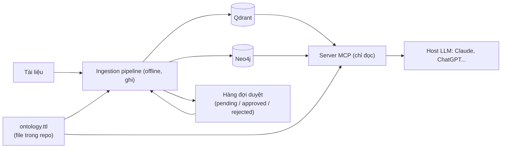

# Ontology nhẹ và quy trình nạp quan hệ: tóm tắt quyết định

> **File này là bản "dễ nhớ"** gom các quyết định đã trao đổi về ontology, nạp quan hệ vào graph và lớp MCP. Chi tiết và lý do nằm ở các file được trỏ tới ở cột cuối. Mọi thứ ở đây là **đề xuất** của nhóm **[suy luận]**, chưa vào `docs/design/`, chưa hiện thực, chưa chạy thử.
>
> **Lưu ý nhất quán:** `06_Applicability_to_Thesis.md` chưa được cập nhật theo hướng này (theo yêu cầu giữ nguyên file đó), nên khuyến nghị cũ ở `06` (OKF profile, "chỉ mượn ý ontology") có thể mâu thuẫn với bảng dưới; `11` §5 cũng còn trỏ `06` cho OKF profile. Khi hai nơi khác nhau, lấy file này.

## 1. Quyết định đã chốt (theo trao đổi)

| Chủ đề | Quyết định | Chi tiết ở |
|---|---|---|
| Kiến trúc lưu trữ | Giữ **graph + vector Boomerang**: Qdrant giữ chunk và payload, Neo4j giữ triplet kèm `Chunk_ID` | `15`, `timeline_summarization/03` |
| Ontology | **Ontology nhẹ** là thành phần chính thức của hệ thống. **Không** dựng triple store, không chạy reasoner | `01` §5, §5.1 |
| Cách viết ontology | **Turtle: phần chuẩn (RDFS + SKOS) cộng thuộc tính tự đặt** (`:temporal`, `:exclusiveBy`, khai báo `owl:AnnotationProperty`). Đọc bằng rdflib. Luật theo thời gian do code thực thi | `01` §5.1 |
| Nơi lưu ontology | **File Turtle trong repo, thư mục `ontologies/` ở gốc, tách khỏi code**; mang vào container bằng mount hoặc copy. Neo4j chỉ giữ dữ liệu KG | `01` §5.1 (phương án A), §9 |
| Lõi và miền | Ontology chia hai tầng: **lõi dùng chung** (`core.ttl`) và **gói riêng cho từng bộ dữ liệu/miền** (một file mỗi gói). Thêm bộ dữ liệu = thêm file và đổi config, không sửa code | `01` §5.1, §9 |
| Jena / Fuseki | **Không dùng** trong kiến trúc chính (ontology nhỏ, đọc bằng rdflib; luật thời gian OWL không biểu diễn được; thêm dịch vụ Java + SPARQL). Có thể thêm Fuseki như thí nghiệm phụ (profile Compose riêng) sau khi ontology nhẹ chạy được | §8, §9 |
| Tần suất đổi | KG đổi liên tục; ontology đổi **nhiều lúc đầu rồi thưa dần**. Gắn **số phiên bản ontology** vào dữ liệu đã nạp | cuộc trao đổi, `01` §5.1 |
| OKF | **Không** làm nền lưu trữ hay ontology (còn mới, thiếu ngữ nghĩa, không có truy vấn). Chỉ là lớp xuất tùy chọn, làm sau cùng | `09`, `01` §5.1 |
| LLM wiki | Chỉ là ý tưởng, mượn ý "lint" | `10` |
| Zep, Mem0 | Chỉ **tham khảo và baseline mô phỏng**, không dùng làm nền | `07`, `08`, `11` §2 |
| MCP | Vỏ **chỉ đọc**; tool gồm `resolve_entity`, `search`, `fetch`, `get_timeline`, `get_state_at`, `list_changes`, `get_schema`. Cơ chế 3 không có tool riêng, chạy ở Ingestion. Tool về thực thể nhận `entity_id`; `resolve_entity` trả `exact`/`ambiguous`/`not_found` kèm ứng viên, host LLM quyết định hỏi lại người dùng | `05` §5, `12` §5A |
| Phạm vi triển khai | Cốt lõi: **lõi `TemporalMemory` + vỏ MCP** (thầy gợi ý không xây lại agent). Vỏ chatbot và harness đo là đề xuất thêm, chưa quyết định làm | `12` §1 |
| Thư viện MCP | SDK Python chính thức (đề xuất) hoặc FastMCP; chưa chốt | `05` §6 |
| Ngoài phạm vi | Xung đột **đa nguồn theo độ uy tín** | `decisions/09` |

## 2. Ba thành phần phải xây



| Thành phần | Việc | Đọc/ghi |
|---|---|---|
| **Ingestion pipeline** | Cắt chunk, trích thực thể và quan hệ, gộp thực thể, chuẩn hóa theo ontology, kiểm ràng buộc, đóng `end_time` (Evolution) hoặc đặt `invalidated_at` (Falsehood), ghi Qdrant và Neo4j | Ghi |
| **Hàng đợi duyệt** | Dữ liệu (bảng hoặc JSONL) cộng cách thao tác tối thiểu (CLI hoặc Streamlit nhỏ). Khi chạy thực nghiệm dùng **chính sách tự động** để tái lập | Ghi |
| **Server MCP** | Trả lời truy vấn; Cơ chế 1 qua `search`/`fetch`, Cơ chế 2 qua `get_timeline`/`get_state_at` | Chỉ đọc |

## 3. Quy trình nạp quan hệ

1. **Đơn vị xử lý:** lô chunk của cùng một trang (pipeline hiện tại đã dùng lô tối đa 30 chunk, `design/03` §2.2) để LLM thấy ngữ cảnh cả trang.
2. **Prompt riêng** cho quan hệ (ví dụ `relation_extractor_v1.md`), tách khỏi prompt trích mốc thời gian để không làm lệch kết quả đã đo của Cơ chế 1 (`decisions/03`).
3. **LLM nhận:** chunk có đánh số `[C1]…`, ontology (loại thực thể, quan hệ cho phép, alias), vài thực thể giống trong KG (top-k). Cho phép ghi `OTHER` kèm tên tự do.
4. **Gán về chunk bằng mã chunk**, không chép nguyên văn; code kiểm mã tồn tại và tên thực thể có trong chunk đó.
5. **Chuẩn hóa:** so quan hệ với ontology bằng alias, embedding, kiểu `domain/range`; không dựa chủ yếu vào confidence LLM tự gán.
6. **Kiểm ràng buộc theo thời gian** (ví dụ một chức một người tại một thời điểm); vi phạm thì phân loại Evolution, Falsehood hoặc gắn cờ.
7. **Kết quả duyệt:** khớp quan hệ có sẵn (chỉ ghi KG); quan hệ mới được chấp nhận (thêm vào ontology, tăng phiên bản); từ chối.

**Hàng đợi duyệt chứa gì [suy luận].** Mỗi mục là một **đề xuất của pipeline chưa chắc chắn**, và phần lớn là về **KG**, chỉ một loại chạm tới ontology:

| Loại mục | Câu hỏi cần chốt | Duyệt xong thì sửa |
|---|---|---|
| Quan hệ mơ hồ | Quan hệ LLM đưa ra (`OTHER` hoặc khớp yếu) có ánh xạ vào quan hệ nào có sẵn? | **KG** (ghi cạnh); nếu đồng ý đó là quan hệ mới thì **thêm vào ontology**, tăng phiên bản |
| Gộp thực thể mơ hồ | "Ông A" trong bài này có phải nút `#123` đã có không? | **KG** (gộp hay tạo nút mới) |
| Vi phạm ràng buộc | Hai người cùng giữ một chức tại một thời điểm: Evolution, Falsehood hay chưa rõ? | **KG** (đóng `end_time` hoặc đặt `invalidated_at`) |
| Mã chunk không hợp lệ | LLM dẫn chunk mà tên thực thể không có trong chunk đó | **KG** (gán lại chunk hoặc bỏ bộ ba) |

Chỉ dòng đầu, khi đề xuất quan hệ mới được chấp nhận, mới làm đổi ontology; các dòng khác chỉ đổi KG. Vì vậy ontology đổi thưa hơn nhiều so với KG.

## 4. Câu hỏi còn mở

| # | Câu hỏi | Ghi chú |
|---|---|---|
| 1 | Mốc thời gian **cho từng bộ ba** hay dùng mốc chunk? | Một chunk có thể chứa nhiều sự kiện; pipeline hiện chỉ có `start`/`end` mức chunk |
| 2 | Routing `search` hay `get_timeline` do host LLM chọn, hay server có tool `ask` kèm Profiler? | `12` §5, ba cách |
| 3 | Chính sách tự động cho đề xuất mơ hồ khi chạy thực nghiệm | Ghi tạm quan hệ chung hay bỏ qua |
| 4 | Công cụ NER cho tiếng Việt | **[chưa kiểm]**; hiện giả định LLM làm luôn |
| 5 | Có xuất Turtle/JSON-LD/OKF ở cuối không | Việc phụ |
| 6 | SDK chính thức hay FastMCP | Cả hai đang được cập nhật (đo 31/10/2026) |
| 7 | File Turtle mẫu đọc được bằng rdflib và mở được bằng Protégé không | **Chưa thử** |
| 8 | Docker Compose mẫu ở `15` §8 | **Chưa chạy thử** |
| 9 | Tình trạng chuẩn RDF 1.2 / SPARQL 1.2; các trang W3C trả 403 | Cần đối chiếu nguyên văn trước khi trích |
| 10 | Chạy thật trên claude.ai/ChatGPT (cần HTTPS công khai) hay đủ Claude Desktop/Code + Open WebUI | `12` |
| 11 | Ontology có thật sự cải thiện Cơ chế 2/3 không, đo bằng ablation có/không ontology | Xem mục 6 |

## 5. Bước tiếp theo gợi ý (theo thứ tự)

1. Viết **ontology lõi + gói miền tiểu sử** khoảng 10 quan hệ (Turtle), kèm vài câu hỏi cần trả lời (competency questions).
2. Thử đọc file đó bằng rdflib và mở bằng Protégé (mục 7 ở bảng trên).
3. Viết prompt `relation_extractor_v1.md` và chạy thử trên một trang đã có trong kho; xem tỉ lệ đề xuất không khớp ontology.
4. Dựng hàng đợi duyệt tối thiểu và chính sách tự động.
5. Bọc lõi bằng server MCP chỉ đọc; thử bằng MCP Inspector và Claude Code.
6. Sau cùng mới cân nhắc lớp xuất (Turtle/JSON-LD/OKF).

## 6. Khi nào ontology đáng dùng, và giữ benchmark sạch

**Ontology giúp được cơ chế nào [suy luận]:**

| Cơ chế | Cần ontology? | Vì sao |
|---|---|---|
| **1. Temporal Retrieval** | **Không cần** (chỉ trường `domain` ở payload) | Chạy trên VectorDB; `11` §4 đã kết luận không cần graph |
| **2. Timeline Summarization** | **Có ích** | Gom chuỗi sự kiện của một thực thể cần từ vựng quan hệ nhất quán (`holds_position`…) và loại thực thể |
| **3. Conflict Resolution** | **Có ích khi mâu thuẫn ở mức quan hệ** | Phát hiện hai phát biểu cùng "ô" (thực thể, quan hệ) cần quan hệ đã chuẩn hóa. Nếu mâu thuẫn chỉ ở mức đoạn văn (bản sửa Wikipedia, sửa đổi theo điều khoản) thì chunk và diff đã đủ, chưa cần ontology |

**Tính chất bộ dữ liệu khiến ontology đáng giá:** thực thể lặp lại qua nhiều tài liệu; có quan hệ loại trừ theo thời gian (người giữ chức, vợ/chồng, nơi làm việc); nhiều tài liệu diễn đạt cùng một quan hệ bằng chữ khác nhau; nhiều miền. **Ít đáng giá:** hỏi đáp trên một đoạn có chunk gold (kiểu TempRAGEval, TimeQA ở mức truy xuất), hội thoại cá nhân. Nghĩa là ontology là thành phần **hỗ trợ** cho Cơ chế 2 và một phần Cơ chế 3, chứ không phải điều kiện của Cơ chế 1.

**Ontology chung hay mỗi bộ dữ liệu một cái [suy luận].** Nếu dùng nhiều bộ dữ liệu khác nhau (ví dụ TimeQA, TLQA, ECT-QA…), mỗi bộ thuộc miền khác nhau (tiểu sử, thể thao và chính trị, báo cáo thu nhập), thì **mỗi bộ thường cần một gói ontology theo miền riêng**, dựa trên **lõi dùng chung**. Gói được dùng lại nếu hai bộ cùng miền (ví dụ gói tiểu sử cho các bộ lấy từ Wikipedia). Cần phân biệt hai tầng:
- **Lõi chung:** `Entity`, `Event`, cạnh có `start_time`, `end_time`, `invalidated_at`, nguồn. Không đổi.
- **Gói theo miền hoặc theo bộ dữ liệu:** loại thực thể và quan hệ riêng, do bạn (hoặc quy trình tự động) tạo.

Nhiều bộ dữ liệu thì công sức viết tay tăng và nguy cơ "can thiệp" cũng tăng, nên cần giảm can thiệp thủ công (xem dưới). Cơ chế 1 trên các bộ chỉ cần truy xuất (không cần graph) thì không phải tạo gói nào.

**Giữ benchmark hợp lệ khi mình tự tạo ontology [suy luận]:** việc xây ontology chỉ ảnh hưởng cách tổ chức dữ liệu của **kho**, không đụng đáp án, nhưng vẫn có nguy cơ rò rỉ nếu nhìn vào test. Quy tắc:
1. **Chỉ xây ontology từ miền và từ tập `tune`/`valid`**, không đọc câu hỏi hay đáp án của `test_clean` (đã có chia train/valid/test ở `decisions/08`).
2. **Khóa phiên bản ontology trước khi chạy `test_clean`** (một lần), ghi phiên bản vào kết quả, giống cách đã làm với prompt (`decisions/03`).
3. **Đo độ phủ trên test:** tỉ lệ đề xuất không khớp ontology (`OTHER`) ở test so với tune, để chứng minh ontology không bị khớp riêng cho tune.
4. **Giảm can thiệp tay bằng quy trình tự động:** mỗi gói chỉ do một lượt sinh từ tập `dev`/`train` của bộ đó rồi khóa, hạn chế số quan hệ và số lần chỉnh tay, ghi lại số giờ công. Chế độ schema-free của EDC (bên dưới) là một cách tạo gói tự động như vậy.
5. **So có/không ontology** (ablation) và so với baseline RAG không dùng ontology, để thấy đóng góp thật. Ghi công sức viết tay ontology như một chi phí/hạn chế.

**Cơ chế 2 dùng ontology lúc truy vấn thế nào [suy luận, chưa chạy thử].** Ontology không tự tìm; nó **thu hẹp phạm vi** để duyệt graph gọn và đúng chủ đề:
1. Vector search tìm nút khởi đầu (thực thể) như thiết kế hiện tại (`design/01`).
2. Từ ontology tra **nhóm quan hệ thuộc chủ đề** của câu hỏi. Ví dụ "sự nghiệp" gồm `holds_position`, `founded`, `awarded`, `joined`, còn `arrested` hay `bought` thì không thuộc nhóm đó. Cần một thuộc tính tự đặt trong ontology để gắn quan hệ vào chủ đề (ví dụ `:partOfTopic :career`).
3. Duyệt graph **chỉ theo các loại quan hệ đó**, lọc `invalidated_at IS NULL` (tùy loại câu hỏi) và `start_time <= T_req`, sắp theo `start_time`; mở rộng lớp con nếu cần (hỏi "lãnh đạo" thì gồm cả "chủ tịch").
4. Trả triplet gọn; cần chi tiết thì `Chunk_ID` quay về Qdrant (Boomerang).

Không có ontology thì phải duyệt mọi loại cạnh quanh nút, lẫn cả sự kiện không liên quan chủ đề.

Điểm cần cân nhắc thêm:
- `:partOfTopic` là thuộc tính tự đặt, cùng loại với `:temporal` và `:exclusiveBy` (khai báo `owl:AnnotationProperty`); chuẩn không có sẵn khái niệm "quan hệ thuộc chủ đề".
- Một quan hệ có thể thuộc **nhiều chủ đề** (ví dụ `awarded` vừa thuộc `:career` vừa thuộc `:achievements`), nên cho phép khai báo nhiều giá trị.
- Câu hỏi **nằm ngoài các chủ đề đã khai báo** thì rơi về duyệt toàn bộ cạnh (như khi không có ontology), không trả rỗng.
- Việc xác định chủ đề của câu hỏi (từ câu hỏi sang `:career`) do Query Profiler hoặc LLM làm; đây gắn với câu hỏi mở về routing ở §4.

## 7. EDC và có nên dùng không

**EDC (Extract-Define-Canonicalize)** là khung dựng đồ thị tri thức bằng LLM của Bowen Zhang và Harold Soh, EMNLP 2024 (arXiv 2404.03868; đọc abstract ngày 31/10/2026). Ba bước: (1) **Extract:** trích bộ ba tự do (Open IE); (2) **Define:** xác định lược đồ, tức là gán định nghĩa cho các quan hệ vừa trích; (3) **Canonicalize:** chuẩn hóa về lược đồ. Có hai chế độ: **schema-given** (có sẵn lược đồ đích) và **schema-free** (tự dựng lược đồ gọn và tự chuẩn hóa). Abstract còn nêu một thành phần **huấn luyện** để truy hồi phần tử lược đồ liên quan cho văn bản đầu vào, cải thiện trích xuất kiểu RAG. Chi tiết từng bước (ví dụ Define là LLM viết định nghĩa tự nhiên cho từng quan hệ, Canonicalize dùng độ gần về embedding rồi LLM xác nhận) là hiểu biết chung của tôi, chưa đọc toàn văn.

**Có nên dùng nguyên EDC? Gợi ý: không, dùng bản nhẹ [suy luận].**
- Lý do không dùng nguyên: cả 3 bước đều gọi LLM cho mọi tài liệu, tốn chi phí nạp (chi phí ingestion bằng LLM đã là hạn chế của đồ án); thêm một khung ngoài phải học và tích hợp; con đường chính (đưa ontology vào prompt) đã gần chế độ schema-given.
- **Bản nhẹ:** giữ đường chính theo schema; chỉ khi LLM trả `OTHER` mới chạy kiểu EDC: LLM viết **định nghĩa** cho quan hệ lạ (Define), rồi so định nghĩa/embedding với mô tả các quan hệ trong ontology (Canonicalize). Ontology cần có mô tả cho mỗi quan hệ (`rdfs:comment`) để so được.
- **Chế độ schema-free** đáng thử để **tự sinh gói ontology ban đầu** cho bộ dữ liệu mới từ tập `dev`, giảm viết tay.
- Đo thử bằng ablation trên mẫu nhỏ trước khi đưa vào pipeline chính.

## 8. Hỏi đáp ngắn

**MCP là backend hay luồng nạp dữ liệu? [suy luận]** "MCP" chỉ là **vỏ phục vụ** (server), giống tầng API của một backend nhưng dành cho LLM: nó tự khai báo tool và tham số để model biết cách gọi. **Luồng nạp (ETL/ingestion) là chương trình riêng**, chạy offline để điền Qdrant và Neo4j; MCP chỉ **đọc** dữ liệu đã nạp. Không nên cho MCP thực hiện ghi/nạp: tăng rủi ro an toàn (`05` §5). Nghĩa là cả hệ thống = ingestion + hai kho dữ liệu + server MCP; chỉ phần cuối mới gọi là MCP.

**Vì sao không dùng reasoner? [kiến thức chung, suy luận]** Reasoner suy ra điều chưa ghi từ luật (lớp con, quan hệ ngược, bắc cầu, kiểm tra nhất quán). Không dùng ở đây vì:
1. Luật quan trọng nhất (loại trừ **theo thời gian**) OWL không biểu diễn trực tiếp.
2. OWL theo thế giới mở và không mặc định hai tên là hai người khác nhau, nên dữ liệu vi phạm luật **không bị báo lỗi** (xem `01` §7.5).
3. Reasoner cần kho RDF/OWL, còn dữ liệu của đồ án ở Neo4j.
4. Phần suy diễn thật sự cần (ví dụ truy vấn "lãnh đạo" thì gồm cả "chủ tịch" nhờ quan hệ lớp con; quan hệ ngược) làm được bằng vài dòng code hoặc Cypher, hoặc suy ra sẵn lúc nạp.

Không phải cấm: nếu muốn thử, dùng reasoner nhỏ (ví dụ owlrl hoặc owlready2 với HermiT, `01` §2B) trên ontology nhỏ như một thí nghiệm phụ.

## 9. Quy hoạch thư mục code và Docker [suy luận, chưa hiện thực]

Căn cứ: code hiện có trong `src/tam` (đã đọc `docs/process/00_FOLDER_STRUCTURE.md`, README của `stores/` và `retrieval/`, `pyproject.toml`, `config.dev.yaml`; chưa đối chiếu `docs/planning/01` §3). Lưu ý: `CLAUDE.md` còn ghi repo "chỉ có tài liệu" nhưng thực tế đã có package `tam` và test.

**Mẫu đang dùng, cứ theo:** mỗi tầng có ABC cùng hàm tạo từ config, chỉ một file biết công nghệ cụ thể (`VectorStore` → `qdrant_store.py`); `Retriever` ABC với `mechanism` temporal/timeline/conflict, các cơ chế nằm cạnh nhau; config chọn theo `profiles` và `roles`; prompt đánh phiên bản `_v<N>`; phụ thuộc tiêm qua constructor, chỉ nơi lắp ráp (`pipeline/builder.py`, `scripts/*`) mới tạo đối tượng. Tài liệu đã nhắc sẵn `pipeline/`, `agents/`, `tools/`, `baselines/`.

**Tách code ontology khỏi dữ liệu ontology.** Code (đọc, truy vấn, kiểm) là chung; dữ liệu (`.ttl`) là riêng từng bộ dữ liệu, nên không để lẫn trong package.

```
ontologies/                    # MỚI, gốc repo, cạnh dataset/
├── core.ttl                   #   lõi chung
└── packs/<bo_du_lieu>.ttl     #   mỗi bộ dữ liệu/miền một gói
src/tam/
├── config/ schemas/ embedding/ llm/       # giữ nguyên
├── ontology/                  # MỚI: chỉ code
│   ├── loader.py              #   Turtle → OntologyView (rdflib)
│   ├── view.py                #   relations(topic), subclasses(rel), is_temporal, exclusive_by
│   └── validator.py           #   kiểm bộ ba theo ràng buộc
├── entities/                  # MỚI, dùng chung cho ingestion và query
│   └── alias_index.py, resolver.py   # alias, khớp mờ, status exact/ambiguous/not_found
├── stores/
│   ├── vector/                #   giữ nguyên
│   └── graph/                 #   MỚI: base.py (ABC GraphStore), neo4j_store.py (Cypher chỉ nằm ở đây)
├── ingestion/                 #   giữ time_extraction; THÊM relations/ (extractor, canonicalize, review_queue)
├── retrieval/
│   ├── temporal/              #   giữ nguyên (đã đo)
│   ├── timeline/              #   MỚI: Cơ chế 2, dùng GraphStore + OntologyView
│   └── conflict/              #   sau này
├── baselines/                 #   plain RAG, tra trạng thái trên graph, mô phỏng Zep/Mem0
├── memory.py                  # MỚI: TemporalMemory (facade), API công khai của lõi
├── tools/                     # MỚI: một định nghĩa tool (tên, tham số, mô tả, khung kết quả)
├── pipeline/builder.py        #   lắp ráp từ config
└── llm/prompts/relation_extractor_v1.md   # prompt riêng, không đụng time_extractor_v*
apps/                          # MỚI, ngoài package lõi
├── mcp_server/                #   vỏ MCP mỏng, đọc tools/
└── chat_demo/                 #   tùy chọn, tính sau
```

- **Config:** thêm mục `graph_store`, `ontology` (`core`, `packs: [tên gói]`, phiên bản), `mcp` (transport, cổng), role `relation_extractor`.
- **`pyproject.toml`:** tách phụ thuộc thành extras (`[graph]` cho neo4j và rdflib, `[mcp]` cho SDK MCP) để lõi không bị kéo thêm.
- **Quy tắc phụ thuộc:** `schemas` → (`ontology`, `stores`, `entities`) → (`ingestion`, `retrieval`) → `memory.py` → `tools` → (`apps/mcp_server`, `evaluation`/`scripts`). Lõi **không bao giờ** import thư viện MCP.
- **Vì sao tách `entities/`:** nạp dữ liệu (gom alias) và truy vấn (`resolve_entity`) cùng cần logic này; để trong `ingestion/` thì `query` phải import ngược.
- **Không di chuyển code cũ.** Chỉ thêm thư mục mới cạnh; giữ `retrieval/temporal/` nguyên để kết quả đã đo không bị ảnh hưởng.
- **Mở rộng:** thêm bộ dữ liệu = thêm một `.ttl` và đổi config; đổi Neo4j = thêm một file store; thêm Cơ chế 3 = thêm `retrieval/conflict/`; thêm đường truy cập mới (REST, function-calling) = thêm một app đọc cùng `tools/`; sửa prompt = thêm `_v2` (cache khóa theo nội dung nên không lẫn).

**Docker.** Chỉ gồm Qdrant, Neo4j và ứng dụng; ontology là file mount hoặc copy vào ứng dụng, không có container riêng. Jena/Fuseki chỉ thêm như thí nghiệm phụ (SPARQL, reasoner, SHACL) trong profile Compose riêng, không chạy mặc định (lý do không dùng làm nền: §8 và `01` §5.1).

**Việc dọn kèm:** `docker/` đang chứa dữ liệu volume (Qdrant, log Neo4j) mà các file đó **đã nằm trong git** (`git ls-files` liệt kê chúng); nên cho vào `.gitignore`. `Dockerfile` của ứng dụng đặt riêng (ví dụ `deploy/`). `docs/process/00_FOLDER_STRUCTURE.md` là ảnh chụp ngày 09/10, cần cập nhật khi code thật sự thêm thư mục.

## Tài liệu tham khảo (docs, git)

- Trong thư mục này: `01` §5–§5.1, `05` §5–§6, `07`, `08`, `09`, `10`, `11` §2, `12` (§1, §5A), `14`, `15`.
- Trong repo: [`docs/process/00_FOLDER_STRUCTURE.md`](../../process/00_FOLDER_STRUCTURE.md) (cấu trúc code hiện có).
- Trong repo: [`docs/decisions/03_PROMPT_CHANGELOG.md`](../../decisions/03_PROMPT_CHANGELOG.md), [`docs/decisions/09_CONFLICT_RESOLUTION_SCOPE.md`](../../decisions/09_CONFLICT_RESOLUTION_SCOPE.md), [`docs/design/03_TEMPORAL_RETRIEVAL_DESIGN_V2.md`](../../design/03_TEMPORAL_RETRIEVAL_DESIGN_V2.md).
- Bài CDOI (`local/docs/REPORT_UDAI.pdf`, thư mục `local/` không nằm trong git): tham khảo về ứng viên so với tri thức, cổng duyệt, ontology theo miền, phiên bản bất biến.
