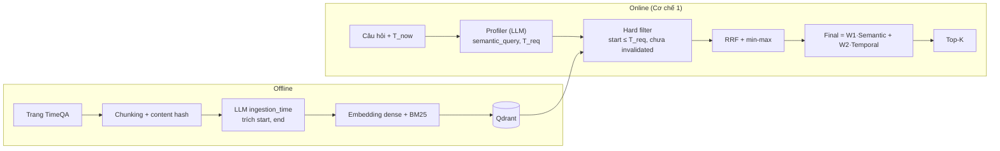

# Báo cáo tuần 3

Tuần này chuyển từ thiết kế sang **code nền tảng của Giai đoạn 1** (Cơ chế 1: Temporal Retrieval): cấu hình và logging, schema và Qdrant, embedding/LLM theo factory, lõi truy xuất, Profiler, metric và ingestion. Các commit nằm trong 9 đến 10/10 (xem `git log`). **Chưa có số liệu truy xuất trên dữ liệu thật**; mới có test đơn vị và bộ dữ liệu giả 15 chunk. Số liệu đầu tiên là của tuần 4.

Kế hoạch code: [`docs/planning/01_TEMPORAL_RETRIEVAL_IMPLEMENTATION.md`](../../planning/01_TEMPORAL_RETRIEVAL_IMPLEMENTATION.md). Thiết kế thuật toán (bản gốc, không đổi trong tuần): [`docs/design/02_TEMPORAL_RETRIEVAL_DESIGN.md`](../../design/02_TEMPORAL_RETRIEVAL_DESIGN.md). Nhật ký chi tiết từng bước: [`docs/process/01` đến `05`](../../process/).

---

## 1. Kế hoạch code và nguyên tắc chung

- Package Python tên **`tam`** (*Time-Aware Memory*). Phạm vi tuần này: ingestion TimeQA, Qdrant (dense + BM25), Time Extractor, hard filter, `Temporal_Score`, RRF + min-max, re-rank, metric. Chưa làm GraphDB, Cơ chế 2 và 3, router, agent.
- **Dùng LLM nhưng chưa dùng agent tự trị**: luồng online chỉ có hai lệnh gọi LLM (Profiler, sinh đáp án), phần truy xuất là code tất định để kết quả tái lập được và dễ so với baseline. Chỗ đặt cho agent về sau đã chừa sẵn.
- **Mọi thứ phụ thuộc bên ngoài đều tiêm vào** (LLM, đồng hồ `t_now`, kho vector) và là ABC + factory, nên test bằng đối tượng giả và đổi nhà cung cấp bằng cấu hình.

---

## 2. Nền tảng: cấu hình, schema, kho vector, embedding, LLM

| Hạng mục | Việc đã làm | Ghi chú |
|---|---|---|
| Cấu hình | `configs/config.dev.yaml`, `config.prod.yaml`, `.env` (không commit), `.example.env` | Dev dùng model rẻ và bộ nhỏ; prod dùng model mạnh. Log theo từng lần chạy vào `output/<timestamp>/` |
| Schema | `schemas/{chunk,query,result}.py` (pydantic) | `Chunk` kiểm tra `end_time >= start_time`; datetime luôn UTC |
| Kho vector | `stores/vector/{base,qdrant_store}.py`, `docker-compose.yml` | Hai danh sách xếp hạng riêng (dense, BM25); point id = `uuid5(chunk_id)` nên upsert lặp không tạo bản sao; **đúng 4 payload index** (`start_time`, `invalidated_at`, `domain`, `country`) |
| Embedding | `embedding/` (ABC + registry + factory), `fastembed` | `BAAI/bge-small-en-v1.5` (dense) và `Qdrant/bm25` (sparse), chọn theo profile |
| LLM | `llm/` (registry + factory theo `role`), provider Anthropic, OpenAI, Ollama và cổng `9router` | Mỗi chỗ gọi LLM trỏ tới một profile (Profiler, nạp kho, sinh đáp án, judge); có cache và chờ-thử-lại khi lỗi tạm thời |
| Neo4j | `docker-compose.yml` | Chỉ để sẵn cho Cơ chế 2 (GraphDB), chưa dùng |

Hai điểm kiểm chứng sớm: mốc **trước 1970** (năm 1850) đi vòng qua Qdrant (payload và range filter) vẫn đúng; một chunk upsert hai lần không nhân đôi.

---

## 3. Lõi Cơ chế 1 (`retrieval/temporal/`)

Hiện thực đúng thiết kế gốc (design 02):

| Module | Việc | Chi tiết quan trọng |
|---|---|---|
| `filters.py` | Hard filter chạy **trong Qdrant, trước khi xếp hạng** | `start_time <= T_req` và `invalidated_at IS NULL`; chỉ nhận facet nằm trong 4 payload index. Có thêm chốt chặn trong Python: store trả hit vi phạm thì bị loại và ghi cảnh báo |
| `fusion.py` | RRF (k = 60) rồi min-max | Min-max trên đúng tập top-N sau khi cắt; hòa điểm giữ thứ tự gặp đầu để tất định |
| `scoring.py` | `Temporal_Score` hai trường hợp | **TH1**: `T_req ∈ [start, end]` (`end` rỗng = còn hiệu lực) thì 1.0; **TH2**: lùi về quá khứ gần nhất thì `exp(-λ·Δyears)`. Chunk có `start > T_req` là lỗi (ném ngoại lệ), không chấm im lặng |
| `retriever.py` | `TemporalRetriever` ghép các bước | `Final = W1·Semantic + W2·Temporal` (0.7 / 0.3), hòa điểm xếp theo `temporal` rồi `chunk_id` |

Test: dữ liệu giả `tests/fixtures/temporal_corpus.json` (15 chunk, 5 lĩnh vực, 11 case có đáp án mong đợi, gồm luật không có bản mới để ép TH2, chunk tin giả `invalidated_at`, mốc trước 1970), kho giả `FakeVectorStore` nên test không cần Qdrant. Lúc này 78 test xanh, 4 xfail có chủ đích.

---

## 4. Profiler, metric và ingestion

### 4.1 Profiler (Time Extractor lúc truy vấn)

- `Profiler(llm).profile(question, t_now)` gọi LLM với prompt `time_extractor_v1.md` (tiếng Anh vì TimeQA là tiếng Anh, 8 ví dụ few-shot, `T_now` đi qua chỗ giữ chỗ `{t_now}`), trả `semantic_query`, `t_req`, `domain`, `country`.
- Code chuẩn hóa lại thay vì tin hoàn toàn LLM: `t_req` đọc bằng `isoparse` (chấp nhận `2020`, `2020-03`, `2020-03-01`), câu không nhắc thời gian thì lấy `T_now`, `domain` và `country` chỉ điền khi câu hỏi nêu rõ (đoán sai làm bộ lọc loại mất đáp án).
- Quy ước đang dùng ở bản này: khoảng thời gian lấy **mốc cuối** ("during the 1990s" thành `1999-01-01`) vì `t_req` là một điểm. Đây là điều tuần 4 phải xem lại.

### 4.2 Metric truy xuất (`evaluation/metrics_temporal.py`)

| Metric | Ý nghĩa | Kỳ vọng |
|---|---|---|
| `hit@k` (k = 1, 3, 5), `mrr` | Chunk đúng (theo `chunk_id`) có trong top-k, và nghịch đảo hạng | cao |
| `leakage_rate` | Tỉ lệ câu có chunk với `start_time > T_req` | 0% |
| `invalidated_rate` | Tỉ lệ câu có chunk đã `invalidated_at` | 0% |
| `forbidden_rate` | Tỉ lệ câu có chunk thuộc `expect_absent` (tương lai, tin giả, sai facet) | 0% |

Có chế độ **oracle** (`T_req` lấy từ nhãn, bỏ qua Profiler) để tách lỗi của bước trích thời gian khỏi lỗi truy xuất.

### 4.3 Ingestion (`ingestion/`)

Luồng: tải trang TimeQA, chunk theo cấu trúc (đoạn dataset đã chia khoảng 100 từ) kèm content hash, **một lệnh gọi LLM cho cả lô chunk của cùng một trang** (rẻ hơn gọi từng chunk, và LLM thấy các mốc lân cận để hiểu "năm sau"), chuẩn hóa mốc, embedding, ghi Qdrant. Bất biến được giữ: chunk không có mốc `start` thì **không** vào kho time-aware. Thêm `doc_id` (tài liệu cụ thể) tách khỏi `source` (nơi phát hành, dành cho Cơ chế 3).

---

## 5. Phân tích dữ liệu thật và các vấn đề phát hiện (chưa sửa)

Đọc dữ liệu TimeQA thật (`D/test` 830 câu, `D/train`) để chuẩn bị cho đánh giá, ghi ở [`docs/process/05`](../../process/05_TIME_SEMANTICS_AND_CHUNKING.md):

| Quan sát | Số liệu | Hệ quả |
|---|---|---|
| Đoạn trung vị 69 từ, tối đa đúng 100 từ | đáp án nằm trọn trong một đoạn: 95% | Dùng nguyên đoạn của dataset làm chunk |
| Chunk chứa đáp án có năm bắt đầu của sự kiện | 67%; thêm 6% chỉ có năm ở chunk liền trước/sau; 6% không có năm nào | Cho phép LLM suy mốc từ chunk khác cùng tài liệu |
| Chunk mở đầu bằng đại từ ("He", "The") | 18% | Chunk phụ thuộc ngữ cảnh chunk bên cạnh |
| Ba trạng thái của `end` | còn tiếp diễn / đã kết thúc / không rõ | Dẫn tới `end_status` ở tuần 4 |

Ngoài ra: nhãn `relation` của dataset không dùng làm bộ lọc được, nên đề xuất 8 `domain` + `other`, tối đa 3 nhãn mỗi chunk, do LLM gán lúc nạp (`dataset/full_dataset/TOPICS.md`). Prompt ingestion `ingestion_time_v1.md` đã viết (4 đến 5 ví dụ, quy tắc ba trạng thái `end`).

Tác vụ phụ: sửa lint (`ruff` sạch), thêm README ngắn cho từng module với sơ đồ thứ tự vận hành.

---

### 📌 Kết luận Tuần 3

- **Xong:** toàn bộ khung code Giai đoạn 1 từ cấu hình đến ingestion và Profiler; lõi Cơ chế 1 đúng thiết kế gốc; metric có đo rò rỉ; 121 test xanh (4 xfail có chủ đích) chạy cả với Qdrant thật.
- **Chưa có:** số liệu truy xuất trên TimeQA thật, baseline Plain RAG, bộ câu hỏi và nhãn chunk để đo, bước sinh đáp án.
- **Rủi ro đã thấy từ dữ liệu:** mốc `end` mơ hồ (LLM dễ gán "còn tiếp diễn" sai), chunk không có năm, nhãn domain lẫn hai trục (lĩnh vực và khía cạnh).
- **Tuần sau (tuần 4):** dựng bộ câu hỏi con có nhãn chunk (bộ local rồi bộ thật), chạy ingestion và Profiler bằng LLM thật, thêm baseline Plain RAG, rồi đo và cải tiến từng bước theo số liệu.
