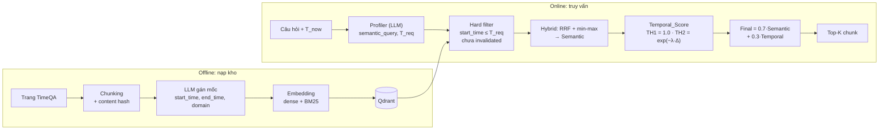

# Báo cáo tuần 3

Tuần này viết **code sườn cho Cơ chế 1 (Temporal Retrieval)**: tìm chunk đúng với **thời điểm** mà câu hỏi nhắc tới, chỉ dùng Vector DB (Qdrant). Phần code gồm nền tảng (cấu hình, schema, kho vector, embedding, LLM), lõi truy xuất theo thời gian, Profiler (trích mốc thời gian từ câu hỏi), ingestion (gán mốc thời gian cho chunk khi nạp kho) và metric.

Tài liệu liên quan:
- Thiết kế thuật toán: [`design/02_TEMPORAL_RETRIEVAL_DESIGN.md`](../../design/02_TEMPORAL_RETRIEVAL_DESIGN.md), kiến trúc chung: [`design/01_INITIAL_BASE_DESIGN.md`](../../design/01_INITIAL_BASE_DESIGN.md)
- Kế hoạch code: [`planning/01_TEMPORAL_RETRIEVAL_IMPLEMENTATION.md`](../../planning/01_TEMPORAL_RETRIEVAL_IMPLEMENTATION.md)

---

## 1. Cơ chế 1: Temporal Retrieval

### 1.1 Bài toán

Cùng một thực thể, thông tin thay đổi theo thời gian. Ví dụ với câu hỏi *"Ai là huấn luyện viên của CLB X vào năm 1995?"*, kho có thể chứa nhiều chunk nói về HLV của CLB X: người làm HLV giai đoạn 1990–1993, người làm 1994–1998, người làm từ 2005 đến nay. Cả ba chunk đều "giống nghĩa" với câu hỏi, nhưng chỉ chunk giai đoạn 1994–1998 là đúng.

**Yêu cầu:** tìm được chunk **đúng ý** (liên quan nội dung câu hỏi) và **đúng thời điểm** (thông tin còn hiệu lực tại thời điểm được hỏi), đồng thời không trả chunk viết về tương lai so với thời điểm hỏi (rò rỉ).

### 1.2 Cách làm

- **Lúc nạp kho (offline):** mỗi chunk được gắn thông tin thời gian `start_time` (khi thông tin bắt đầu đúng) và `end_time` (khi thông tin hết đúng; rỗng nghĩa là còn hiệu lực đến nay). Việc gán do LLM đọc chunk và trích ra.
- **Lúc truy vấn (online):** câu hỏi được đưa qua LLM (Profiler) để tách thành `semantic_query` (phần nội dung cần tìm) và `T_req` (thời gian mà câu hỏi đề cập tới, ở ví dụ trên là 1995). Câu không nhắc thời gian thì `T_req` = thời điểm hiện tại `T_now`.
- **Các quy tắc dùng trong hệ thống:**
  1. **Hard filter** trong Qdrant: chỉ giữ chunk có `start_time ≤ T_req` và chưa bị `invalidated_at`.
  2. Tìm kiếm **hybrid**: dense (nghĩa) và BM25 (từ khóa) cho hai danh sách riêng, trộn bằng RRF rồi chuẩn hóa min-max thành điểm `Semantic`.
  3. Tính điểm `Temporal` cho từng chunk còn lại (xem 1.3).
  4. **Xếp hạng:** `Final = 0.7·Semantic + 0.3·Temporal`, lấy Top-K.



### 1.3 Các khái niệm

**`Semantic` và `Temporal` là hai điểm số (score), cùng nằm trong khoảng [0, 1]:**
- `Semantic`: chunk **giống nghĩa** câu hỏi đến mức nào (từ embedding dense và BM25, sau RRF và min-max). Chỉ đo nội dung, không biết gì về thời gian.
- `Temporal`: chunk **khớp thời điểm** `T_req` đến mức nào. Điểm cao nghĩa là thông tin trong chunk đúng vào lúc được hỏi.
- `Final` là điểm tổng dùng để xếp hạng; hai thành phần cộng có trọng số nên một chunk giống nghĩa nhưng sai thời điểm sẽ bị đẩy xuống.

**`Semantic` được tính bằng RRF rồi min-max:**
- **RRF (Reciprocal Rank Fusion)** trộn hai danh sách xếp hạng (dense và BM25) mà không cần so điểm thô của hai bên, vì điểm cosine và điểm BM25 khác thang đo. RRF chỉ dùng **thứ hạng**: mỗi chunk `d` nhận
  `RRF(d) = Σ 1 / (k + rank_i(d))`, cộng qua các danh sách `i` mà `d` xuất hiện, `rank_i(d)` là hạng của `d` trong danh sách đó (hạng 1 là tốt nhất), `k = 60` là hằng số làm mượt. Chunk đứng cao ở cả hai danh sách được điểm lớn nhất.
  Ví dụ: chunk hạng 1 ở dense và hạng 3 ở BM25 được `1/61 + 1/63 ≈ 0.0323`; chunk chỉ hạng 1 ở một danh sách được `1/61 ≈ 0.0164`.
- **Min-max** đưa điểm RRF về [0, 1] trên tập top-N đã cắt: `Semantic(d) = (RRF(d) − min) / (max − min)`, để cộng được với `Temporal` cùng thang.

**`invalidated_at` (chunk bị vô hiệu):** dấu thời điểm hệ thống phát hiện chunk **sai ngay từ đầu** (tin giả, bị đính chính). Khác với thông tin chỉ thay đổi theo thời gian, chunk có `invalidated_at` bị hard filter loại hẳn khỏi kết quả truy vấn.

**Chunk "đã hết hạn" là gì:** chunk có `end_time < T_req`, tức thông tin trong chunk từng đúng nhưng đã kết thúc trước thời điểm được hỏi. Ví dụ: chunk "A là HLV từ 1990 đến 1993" khi hỏi về năm 1995 là chunk đã hết hạn.

**Vì sao chunk hết hạn vẫn được tính:** hết hạn không có nghĩa là sai. Thông tin cũ vẫn đúng với thời điểm của nó, và nhiều khi kho chỉ có bản cũ (ví dụ hỏi luật năm 2020 nhưng chỉ có bản luật 2018, bản đó vẫn đang là bản áp dụng gần nhất). Vì vậy hệ thống không loại chunk hết hạn mà **giảm điểm** `Temporal` theo độ cũ. Hai trường hợp:

| Trường hợp | Điều kiện | `Temporal` |
|---|---|---|
| **TH1 – khớp thời điểm** | `start_time ≤ T_req ≤ end_time` (`end_time` rỗng = còn hiệu lực) | **1.0** |
| **TH2 – lùi về quá khứ gần nhất** | `end_time < T_req` (đã hết hạn) | `exp(−λ·Δnăm)`, với `Δnăm = T_req − start_time` tính theo năm |

Ở TH2, chunk càng cũ so với `T_req` thì điểm càng thấp; `λ` là tốc độ suy giảm (với `λ = 0.5`: cách 1 năm còn ≈ 0.61, 2 năm ≈ 0.37, 5 năm ≈ 0.08). Nhờ vậy khi có chunk TH1 thì nó thắng; khi không có thì chunk hết hạn gần nhất được chọn thay vì không trả gì.

**Chunk có `start_time > T_req` (viết về tương lai) bị loại bởi hard filter** và nếu lọt tới bước chấm điểm thì code ném lỗi chứ không chấm im lặng.

### 1.4 Lựa chọn thiết kế

Luồng có đúng **hai lần gọi LLM**, phần truy xuất còn lại là code tất định để kết quả tái lập được và dễ so với baseline:
1. **Lúc nạp kho Qdrant:** gọi LLM để lấy `start_time`, `end_time` của nội dung trong chunk (một lệnh gọi cho cả lô chunk của cùng một trang).
2. **Lúc có query:** gọi LLM một lần để lấy ra thời gian mà câu hỏi đề cập tới (`T_req`) và `semantic_query`.

---

## 2. Cấu trúc code

Package Python tên **`tam`** (*Time-Aware Memory*) nằm trong `src/tam/`.

```text
.
├── configs/                  # config.dev.yaml, config.prod.yaml (model, bộ dữ liệu, tham số)
├── docker-compose.yml        # Qdrant (dùng ngay) + Neo4j (để sẵn cho Cơ chế 2)
├── src/tam/
│   ├── config/               # nạp cấu hình, logging theo từng lần chạy
│   ├── schemas/              # kiểu dữ liệu dùng chung (pydantic)
│   ├── stores/vector/        # giao diện kho vector + Qdrant
│   ├── embedding/            # dense + BM25 qua fastembed
│   ├── llm/                  # gọi LLM: provider, cache, prompt
│   ├── ingestion/            # offline: TimeQA → chunk → gán mốc → Qdrant
│   ├── query/                # online: Profiler (câu hỏi → T_req)
│   ├── retrieval/temporal/   # lõi Cơ chế 1: filter, fusion, scoring, retriever
│   └── evaluation/           # metric truy xuất
└── tests/                    # test đơn vị + fixtures/temporal_corpus.json
```

Mỗi thư mục con của `src/tam/` có `README.md` riêng với sơ đồ thứ tự vận hành.
### Chức năng từng thư mục

| Thư mục | Chức năng |
|---|---|
| `config/` | Nạp cấu hình `configs/config.*.yaml` và `.env`, chọn profile dev (model rẻ, bộ nhỏ) hay prod; ghi log theo từng lần chạy vào `output/<timestamp>/` |
| `schemas/` | Kiểu dữ liệu dùng chung (pydantic): `Chunk` (có `start_time`, `end_time`, `invalidated_at`), `Query` (kết quả Profiler), `Result` (chunk kèm điểm) |
| `stores/vector/` | Giao diện kho vector và bản Qdrant: hai danh sách xếp hạng riêng (dense, BM25), upsert idempotent, đúng 4 payload index |
| `embedding/` | Embedding dense (`bge-small-en-v1.5`) và sparse (BM25) qua fastembed, chọn model bằng cấu hình |
| `llm/` | Gọi LLM qua factory theo vai trò (Profiler, nạp kho, sinh đáp án, judge); nhiều provider, có cache và tự thử lại; prompt có số phiên bản |
| `ingestion/` | Offline: tải trang TimeQA, chunk kèm content hash, LLM gán mốc `start`/`end` và domain cho cả lô chunk của một trang, embedding, ghi Qdrant |
| `query/` | Online: Profiler đổi câu hỏi thành `semantic_query` và `T_req`, chuẩn hóa mốc bằng code thay vì tin hoàn toàn LLM |
| `retrieval/temporal/` | Lõi Cơ chế 1: hard filter, hybrid RRF + min-max, `Temporal_Score`, xếp hạng `Final` |
| `evaluation/` | Metric truy xuất: `hit@k`, `mrr`, tỉ lệ rò rỉ tương lai, chunk đã `invalidated`; có chế độ oracle (`T_req` lấy từ nhãn) |
| `tests/` | Test đơn vị trên bộ dữ liệu giả 15 chunk và kho giả, không cần Qdrant; 121 test xanh, 4 xfail có chủ đích |
