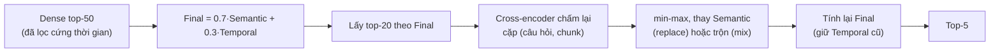

# Báo cáo tuần 4

Tuần này **test Temporal Retrieval (Cơ chế 1) trên bộ data 400 câu lấy từ TimeQA và cải tiến thiết kế theo kết quả test**:
1. Dựng bộ data 400 câu có nhãn chunk đúng.
2. Đánh giá baseline Plain RAG và thiết kế xuất phát (từ tuần 3).
3. Xác định lý do các câu sai.
4. Chỉnh sửa thiết kế theo lý do đó, test lại, lặp lại qua từng lần cải tiến.

**Cải thiện so với Plain RAG.** Plain RAG là RAG thuần, chỉ tìm theo độ giống nghĩa, không có cơ chế kiểm soát thời gian. Kết quả trên bộ data 400 câu:

| Hệ thống | `mrr` | `hit@5` | `ans_valid@5` | `leakage_rate` |
|---|---|---|---|---|
| Plain RAG | 0.339 | 0.549 | 0.409 | 66.5% |
| Thiết kế tuần 3 | 0.386 | 0.627 | 0.624 | 0% |
| Cải tiến sau tuần 4 | **0.566** | **0.795** | 0.710 | 0% |

`leakage_rate` là tỉ lệ câu hỏi mà top-5 có chunk mang nội dung của tương lai so với thời điểm hỏi (ví dụ hỏi về năm 2010 nhưng top-5 lại có chunk của năm 2011). Kỳ vọng là 0%.

Các con số là cận trên vì cấu hình được chọn ngay trên bộ này; phương pháp và từng lần cải tiến nằm ở các mục sau.

Tài liệu liên quan:
- Thiết kế bản gốc: [`design/02`](../../design/02_TEMPORAL_RETRIEVAL_DESIGN.md); bản hiện tại: [`design/03`](../../design/03_TEMPORAL_RETRIEVAL_DESIGN_V2.md)
- Kế hoạch đợt test: [`eval/03`](../../eval/03_TEST_ROUNDS.md); kết quả: [`eval/05`](../../eval/05_REAL_RESULTS.md)

**Quy ước đọc số.** Các chỉ số đều tính trên từng câu hỏi rồi lấy trung bình:
- `hit@k`: chunk đúng (theo id) nằm trong top-k. Ví dụ `hit@5` = 0.72 nghĩa là 72% câu có chunk đúng trong 5 kết quả đầu.
- `mrr`: trung bình của `1/hạng` chunk đúng (hạng 1 được 1.0, hạng 2 được 0.5, ...), thưởng cho việc đưa chunk đúng lên cao.
- `ans_valid@5`: top-5 có chunk vừa chứa chuỗi đáp án vừa **hợp lệ về thời gian** tại `T_req`.
- `leakage_rate`: tỉ lệ câu có chunk bắt đầu sau `T_req` (rò rỉ tương lai), kỳ vọng 0%.
- "± x" là khoảng 95% khi so **ghép cặp từng câu** (cùng bộ câu hỏi, hai cấu hình); trên bộ data 400 câu, chênh dưới khoảng 0.013 đến 0.015 `mrr` là không phân biệt được.

---

## 1. Điểm xuất phát: thiết kế gốc

Thiết kế ở [`design/02`](../../design/02_TEMPORAL_RETRIEVAL_DESIGN.md) và code tuần 3:

| STT | Khâu | Thiết kế gốc |
|---|---|---|
| 1 | Nạp kho Qdrant | LLM trích `start_time`, `end_time` cho từng chunk rồi lưu vào Qdrant; chunk không có mốc thì bỏ |
| 2 | Profiler | LLM trích `T_req` (thời gian mà câu hỏi đề cập tới) từ câu hỏi; khoảng thời gian lấy mốc cuối |
| 3 | Search hybrid | Dense (nghĩa) và BM25 (từ khóa) cho hai danh sách riêng, trộn bằng RRF rồi min-max thành điểm `Semantic` |
| 4 | Lọc chunk theo điều kiện thời gian | Giữ chunk có `start_time ≤ T_req` (loại chunk có nội dung của tương lai so với thời điểm hỏi), `invalidated_at` rỗng (null = chưa bị đánh dấu sai, còn hiệu lực) và đúng `domain` |
| 5 | Chấm điểm và xếp hạng | `Final = 0.7·Semantic + 0.3·Temporal` |

- `Semantic` là điểm giống nghĩa giữa câu hỏi và chunk, lấy từ **RRF** (trộn hạng của dense và BM25) rồi chuẩn hóa min-max về [0, 1].
- `Temporal` là điểm khớp thời gian: bằng 1.0 nếu `T_req ∈ [start_time, end_time]`; nếu chunk đã hết hạn thì `exp(−λ·Δnăm)`, giảm dần theo độ cũ.
- Lúc này chưa có Plain RAG để đối chứng.

---

## 2. Bộ data 400 câu

- **Lấy mẫu:** `scripts/make_eval_subset.py` lấy 400 câu từ TimeQA (8 domain × 50 câu, 204 trang) và đổi vị trí đáp án thành nhãn **chunk đúng** (`gold_chunk_ids`).
- **Chunk:** dùng nguyên các đoạn của dataset (trung vị 69 từ, tối đa 100 từ). Sau khi nạp kho Qdrant có tất cả 6,737 chunk, embedding dense bằng `BAAI/bge-small-en-v1.5`.
- **Gán `start_time`, `end_time` cho chunk:** LLM **Gemini 3.5 flash-lite** đọc từng lô chunk của một trang.
- **Trích `T_req` từ câu hỏi (Profiler):** LLM **Gemini 3.1 flash-lite**.

---

## 3. Chạy thiết kế xuất phát

Thiết kế gốc ở mục 1, thêm Plain RAG làm đối chứng.

**Kết quả:**

| Hệ thống | `mrr` | `hit@5` | `ans_valid@5` | Rò rỉ tương lai |
|---|---|---|---|---|
| Plain RAG dense | 0.339 | 0.549 | 0.409 | 66.5% |
| Temporal Retrieval (hybrid, `stored`, chưa giữ chunk không mốc) | 0.386 | 0.627 | 0.624 | 0% |

Temporal Retrieval hơn Plain RAG ở mọi chỉ số, và loại hết rò rỉ tương lai. Tuy nhiên `hit@5` mới 0.627.

Temporal Retrieval đã cải tiến hơn Plain RAG, nhưng các chỉ số vẫn chưa cao (`hit@5` mới 0.627).

**Lý do các câu sai:**
- **Bị lọc cứng (bước 4) vì nhãn thời gian gán lúc nạp kho Qdrant chưa chuẩn:** `start_time`/`end_time` do LLM gán sai nên chunk đúng bị loại. Ví dụ phức tạp (trang `2AM (band)`):
  - Câu hỏi: *"The band 2AM was associated with which music company between Apr 2010 and Nov 2010?"* (`T_req` = 2010-04), đáp án **Big Hit Entertainment** (đúng từ 2009 đến 2013).
  - Chunk chứa đáp án: *"Members Seulong, Jo Kwon, and Jinwoon all officially switched their contracts back to JYP Entertainment after their contracts with Big Hit Entertainment expired in April ... A new album, Lets Talk would be the first under JYP Entertainment, after releasing their previous albums with Big Hit Entertainment ..."*
  - Đoạn này kể **sự kiện năm 2014** (chuyển sang JYP) và chỉ nhắc Big Hit như chi tiết phụ của thời kỳ trước. LLM gán `start_time` = 2014-04, nên với `T_req` = 2010-04 chunk bị coi là nội dung tương lai (`start_time > T_req`) và **bị lọc cứng mất** dù nó chứa đúng đáp án. Một chunk nói về nhiều thời kỳ nhưng chỉ có một cặp `[start_time, end_time]` là nguồn lỗi chính của nhóm này.
- **Gán `domain` cho chunk lúc nạp kho Qdrant cũng chưa chuẩn:** lọc theo `domain` loại nhầm chunk đúng.
- **`end` rỗng được mặc định hiểu là còn hiệu lực:** chunk mà LLM không ghi được ngày kết thúc luôn có `Temporal = 1.0` nên chen lên trước chunk đúng của thời kỳ sau.
- **Nhiều chunk không mốc lại chứa đáp án đúng.** Thời gian của chúng có thể suy ra từ chunk trước và chunk sau, nên không thể mặc định bỏ (thiết kế gốc bỏ chunk nếu nạp kho Qdrant không nhận diện được mốc).
- **Plain RAG có một số câu đúng mà thiết kế này sai**, vì BM25 trong hybrid kéo chunk đúng xuống hạng thấp.
- Ngoài ra Profiler **không phải điểm nghẽn** (`T_req` nằm trong khoảng nhãn ở 391/400 câu); khó khăn còn lại là chọn đúng chunk trong cùng một trang, khi vài chục chunk cùng chủ đề chỉ khác nhau ở thời kỳ.

---

## 4. Cải tiến lần 1: bỏ BM25, giữ chunk không mốc

**Định hướng:** xử lý các lý do ở mục 3. Chạy 142 kịch bản theo đợt 0 đến 5 ([`eval/03`](../../eval/03_TEST_ROUNDS.md)).

| Cải tiến | Trước | Sau | Kết quả (`mrr`, ghép cặp) |
|---|---|---|---|
| Thử bỏ BM25 | hybrid dense + BM25 | chỉ dense | 0.386 → 0.418 (+0.032 ± 0.025) |
| Giữ lại chunk **không mốc** và cho `Temporal` cố định (`t_unknown`) | bỏ chunk không có `start` | giữ; thử nhiều giá trị `t_unknown` | tốt nhất `t_unknown` = 0.1: 0.418 → 0.441 (+0.023 ± 0.016); 0.0 đến 0.2 gần như ngang nhau, trên 0.5 tệ hơn không giữ |
| `end` có 3 trạng thái và 4 cách chấm | `end` null mặc định là còn hiệu lực (xem mục 3) | `end_status` = `known` / `unknown` / `ongoing` và 4 cách chấm `end_mode` (bảng dưới) | `unknown_decay` so `stored`: +0.003 ± 0.010, **không hơn** |
| `domain` | lọc cứng | không lọc cứng, chỉ **cộng điểm** | không hơn nền; lọc cứng làm giảm (0.381 so 0.386) |
| Chunk liền kề ±1 làm ngữ cảnh (không đổi xếp hạng) | top-5 | top-5 + chunk liền kề | `ctx_hit` (chunk đúng có trong ngữ cảnh) 0.679 → 0.772 |

**Ba trạng thái của `end`:** `known` (có ngày kết thúc), `ongoing` (còn tiếp diễn, LLM phải trích nguyên văn câu bằng chứng, nếu không bị hạ xuống), `unknown` (không rõ).

**Bốn cách chấm `end_mode`** (khác nhau ở cách tính `Temporal` cho chunk `ongoing` và `unknown`):

Ký hiệu: `Δ = T_req − start_time` (năm); `λ` = `decay_lambda` (mặc định 0.5); `d` = `open_decay` (mặc định 0.1, tốc độ giảm nhẹ hơn `λ` vì với chunk không rõ `end` ta không chắc nó đã hết hạn).

| `end_mode` | Chunk `ongoing` | Chunk `unknown` |
|---|---|---|
| `stored` (mặc định) | `1.0` | `1.0` nếu `T_req` còn trong năm của `start`, sau đó `exp(−λ·Δ)` (phạt nặng) |
| `open` | `1.0` | `1.0` |
| `decay` | `exp(−d·Δ)` | `exp(−d·Δ)` |
| `unknown_decay` | `1.0` | `exp(−d·Δ)` |

**Kết quả lần này:** `mrr` 0.441, `hit@5` 0.679, `ans_valid@5` 0.637; so Plain RAG +0.104 ± 0.036 `mrr`.

**Lý do các câu sai còn lại:** `hit@5` vẫn dưới 0.7, nguyên nhân chi tiết được phân tích ở cuối mục 5.

---

## 5. Cải tiến lần 2: Profiler khoảng, `decay_from end`

**Định hướng:** cải tiến lần này kết hợp với lần 1 (chạy trên cùng cấu hình), xuất phát từ hai hạn chế đã thấy ở thiết kế gốc:
- **`T_req` là một điểm nên mất thông tin.** Câu hỏi như "during the 1990s" hay "in 2019" nhắc tới một **khoảng thời gian**, nhưng Profiler gốc ép về một điểm (mốc cuối). Vì vậy đổi sang **Profiler theo khoảng**: LLM trả khoảng thời gian `[qs, qe]` thay vì một điểm `T_req`.
- **Cách phạt chunk hết hạn chưa hợp lý:** `Δ` tính từ `start` (xem `decay_from` bên dưới).

**Vì sao cần giữ chunk hết hạn.** Chunk hết hạn là chunk có `end_time < T_req` (thông tin từng đúng nhưng đã kết thúc trước thời điểm hỏi). Không loại chúng vì (1) nhiều khi kho chỉ có bản cũ, ví dụ hỏi luật năm 2020 nhưng chỉ có bản 2018, thì bản 2018 vẫn là bản áp dụng gần nhất; (2) nhãn `end` do LLM gán có thể sai, chunk "hết hạn" thật ra vẫn còn đúng. Vì vậy chúng được chấm `Temporal = exp(−λ·Δnăm)`, càng cũ điểm càng thấp (trường hợp 2 của `Temporal`).

Hai ví dụ chunk đúng nhưng bị gán nhãn đã hết hạn (nhãn `end` do LLM gán lúc nạp kho Qdrant chưa chuẩn):

| Câu hỏi | `T_req` | Chunk đúng | Nhãn chunk | Thực tế |
|---|---|---|---|---|
| *Albuquerque Dukes play in which division in late 1970s?* (đáp án: Pacific Coast League) | 1977 | "In 1972, the Dukes name was revived and the team moved up to the Triple-A Pacific Coast League." | `1971` đến `1972`, tức đã hết hạn | Đây là **sự kiện** bắt đầu năm 1972, trạng thái "chơi ở Pacific Coast League" kéo dài qua cuối thập niên 70 |
| *What had control of the operation of All Nippon Airways before Jul 1982?* và *... in Sep 1992?* (đáp án: Boeing 747) | 1982 và 1992 | "Boeing 747-200s were introduced on the Tokyo-Sapporo and Tokyo-Fukuoka routes in 1976 ..." | `1976`, đã hết hạn | Máy bay được đưa vào năm 1976 và vẫn khai thác ở cả 1982 lẫn 1992; **cùng một chunk** là chunk đúng của hai câu hỏi cách nhau 10 năm |

Nếu loại thẳng chunk hết hạn thì cả ba câu mất chunk đúng. Giữ lại và chấm `exp(−λ·Δ)` thì chunk đúng vẫn có cơ hội đứng cao, nhất là khi các chunk khác của cùng trang còn kém giống nghĩa hơn.

**`decay_from` là gì.** Nó nằm trong công thức trường hợp 2 `exp(−λ·Δnăm)` và chọn cách tính `Δ`:
- `decay_from = start` (bản gốc): `Δ = T_req − start_time`.
- `decay_from = end`: `Δ = T_req − end_time`.

Ví dụ chunk "A là HLV 1980 đến 1994", hỏi năm 1995: từ `start` thì `Δ` = 15 năm nên điểm rất thấp, dù chunk chỉ hết hạn 1 năm trước; từ `end` thì `Δ` = 1 năm, công bằng hơn với các sự việc kéo dài.

| Khâu | Trước | Sau | Kết quả (`mrr`) |
|---|---|---|---|
| Profiler với khoảng thời gian | "during the 1990s" → `T_req` = 1999-01-01 (mốc cuối) | LLM ghi mốc một phần + `bound` (`exact`/`after`/`before`/`none`), code mở rộng thành khoảng `[1990-01-01, 1999-12-31]` | 0.441 → 0.445 |
| Phạt chunk hết hạn (`decay_from`) | `Δ = T_req − start_time` | `Δ = T_req − end_time` (`decay_from: end`) | +0.006 ± 0.008, nhất quán nhất (0.451) |
| Chunk có `end` không rõ | cố định | chỉ chunk `unknown` giảm dần (`unknown_decay` 0.05) | 0.463 |
| Xếp hạng theo khoảng (`range`) | điểm | điểm chồng lấn khoảng hỏi | +0.002 ± 0.014, **không vượt sai số** |
| Mở rộng cùng trang theo thời gian | liền kề ±2 | lấy chunk cùng trang còn hợp lệ tại `qs` | **Kém hơn** (`ctx_hit` 0.719 so 0.774) |

Thêm chỉ số theo chuỗi đáp án (`ans_hit@k`, `ans_valid_hit@k`): `hit@5` theo id **đánh giá thấp** vì top-5 chứa chuỗi đáp án ở 0.81 câu, so 0.69.

**Kết quả lần này:** `mrr` 0.463, `hit@5` 0.692, `ans_valid@5` 0.632. Các tinh chỉnh ở lớp xếp hạng thời gian đã chạm trần (mỗi cái +0.00 đến +0.01).

**Lý do các câu sai** (phễu từng bước và đọc tay 123 câu sai):
- 94% chunk đúng bị xếp sau top-5 là do **chunk khác của chính trang đáp án** (thời kỳ khác) xếp trước.
  - Ví dụ: *"Scotland's Alex McLeish had the job of coach for what team in Apr 2012?"* (`T_req` = 2012-04). Chunk đúng là #40 của trang: "On 17 June 2011, Aston Villa appointed McLeish as manager" (Villa, 6/2011 đến 5/2012), nhưng chỉ đứng **hạng 15**. Các chunk khác của cùng trang cũng kể "McLeish làm HLV đội X" với từ vựng gần như nhau:

    | Chunk của trang | Nội dung | Thời kỳ | Với `T_req` = 4/2012 |
    |---|---|---|---|
    | #38, #39 | McLeish ở Birmingham City, vô địch League Cup, rồi xuống hạng | 2009 đến 6/2011 | đã hết hạn vài tháng, vẫn qua bộ lọc |
    | **#40 (đúng)** | Aston Villa bổ nhiệm McLeish | 6/2011 đến 5/2012 | khớp thời điểm |
    | #43 | Nottingham Forest bổ nhiệm McLeish | 12/2012 | bị lọc cứng (tương lai) |
    | #45 | Genk bổ nhiệm McLeish | 8/2014 | bị lọc cứng (tương lai) |

    Các chunk cùng một người, cùng một vai trò chỉ khác nhau ở thời kỳ và tên đội, nên điểm `Semantic` rất gần nhau; chunk của thời kỳ khác (như #38, #39) dễ chen lên trước chunk đúng.
- 9.3% câu bị lọc cứng mất chunk đúng vì nhãn chunk nằm sau `T_req`.
- Đọc tay 123 câu sai: **phần lớn là do nhãn thời gian lúc nạp kho Qdrant không khớp thời điểm hỏi**; ví dụ "chuyển tới London năm 1950" bị gán `start = end = 1950` như một trạng thái đã kết thúc, trong khi trạng thái kéo dài.

→ Hướng tiếp theo: sửa nhãn thời gian ngay lúc nạp kho Qdrant.

---

## 6. Cải tiến lần 3: sửa prompt nạp kho Qdrant (`v2` rồi `v3`)

**Định hướng:** từ lý do ở mục 5. Prompt mới phân biệt **sự kiện** với **trạng thái**, không chốt `end` chỉ vì chunk viết một năm:

| Văn bản | Trước (`v1`) | Sau (`v3`) |
|---|---|---|
| "Moved to London in 1950." | `start = 1950`, `end = 1950` (như đã kết thúc) | `start = 1950`, `end` không rõ / còn kéo dài tới khi có sự kiện thay thế |

Nạp kho Qdrant lại toàn bộ 204 trang vào kho riêng (6,752 điểm, 330 lô). Nhãn: `known` 3,974 → 4,596; `unknown` 1,238 → 924; chunk không mốc 1,501 → 1,188.

**Kết quả** (ghép cặp kho `v1` sang `v3`, cấu hình nền, 399 câu):

| Chỉ số | `v1` | `v3` | Chênh lệch ghép cặp |
|---|---|---|---|
| `hit@1` | 0.326 | 0.338 | |
| `hit@5` | 0.692 | 0.723 | +0.033 ± 0.036 |
| `mrr` | 0.463 | 0.478 | +0.016 ± 0.029 |
| `ans_valid@5` | 0.632 | 0.693 | **+0.063 ± 0.042** |
| Chunk đúng bị lọc cứng | 78 | 57 | |


**Lý do các câu sai còn lại** (111/400 câu, `v1` là 123):

| Lý do | Số câu |
|---|---|
| Bị lọc cứng mất chunk đúng | 37 |
| Chunk đúng đã hết hạn, xếp sau top-5 | 30 |
| Chunk hợp lệ nhưng xếp sau top-5 (lỗi nội dung) | 21 |
| Điểm thời gian đẩy chunk đúng ra khỏi top | 16 |
| Không có mốc | 4 |
| Không vào được ứng viên | 3 |

→ Hướng tiếp theo: nhóm lớn nhất còn lại là phân biệt **nội dung** trong cùng trang (xếp sau top-5), nên thêm bước chấm lại.

---

## 7. Cải tiến lần 4: cross-encoder chấm lại

**Cross-encoder** là model đọc **cùng lúc** cặp (câu hỏi, chunk) và cho một điểm liên quan, chính xác hơn embedding (vốn mã hóa câu hỏi và chunk riêng rồi so vector) nhưng chậm hơn, nên chỉ dùng chấm lại một nhóm nhỏ đã được lọc.

**Định hướng:** thêm bước chấm lại bằng cross-encoder (`fastembed`):



**Kết quả** (ghép cặp; dòng đầu là kết quả cuối mục 6, không cross-encoder, để so sánh):

| Model | Độ trễ (20 chunk) | `hit@1` | `hit@5` | `mrr` (Δ) | `ans_valid@5` |
|---|---|---|---|---|---|
| **Nền (kết quả mục 6)**, không cross-encoder | 0 | 0.338 | 0.723 | 0.478 | 0.693 |
| bge-reranker-v2-m3 (int8) | ~980 ms | 0.415 | 0.795 | **0.566 (+0.088 ± 0.015)** | 0.710 |
| MiniLM-L12 | ~160 ms | 0.375 | 0.785 | 0.530 (+0.052 ± 0.012) | 0.713 |
| MiniLM-L6 | ~70 ms | 0.360 | 0.795 | 0.524 (+0.046 ± 0.015) | 0.710 |
| bge-reranker-base | ~770 ms | 0.338 | 0.782 | 0.508 (+0.030 ± 0.016) | 0.700 |
| jina-reranker-v1-turbo | ~120 ms | 0.343 | 0.765 | 0.502 (+0.024 ± 0.009) | 0.710 |

**Cross-encoder cải thiện nhóm câu sai nào của mục 6?** Cross-encoder chạy **sau** bước lọc cứng, nên nó **không cứu được** chunk đúng đã bị lọc cứng mất (37 câu ở mục 6). Nó chỉ xử lý nhóm chunk đúng còn trong 50 ứng viên nhưng xếp sau top-5 (hết hạn 30 câu, hợp lệ nhưng lỗi nội dung 21 câu). Số câu có chunk đúng trong top-5 tăng từ 0.723 lên 0.795 (+0.072, tức khoảng 29/400 câu). Chưa phân tích lại nguyên nhân từng câu sai sau cross-encoder.

Chọn model là đánh đổi độ trễ và chất lượng: L6 (nhanh), L12 (cân bằng), bge-v2-m3 (chất lượng, ~1 giây mỗi 20 chunk).

**Đối chứng công bằng — Plain RAG cũng được thêm cùng cross-encoder** (cùng nhóm top-20):

| | Plain RAG: `mrr` / `ans_valid@5` / rò rỉ | Temporal Retrieval: `mrr` / `ans_valid@5` / rò rỉ |
|---|---|---|
| Không cross-encoder | 0.330 / 0.443 / 70% | 0.478 / 0.693 / 0% |
| + MiniLM-L12 | 0.425 / 0.545 / 66% | 0.528 / 0.705 / 0% |
| + bge-v2-m3 | 0.471 / 0.573 / 70% | 0.560 / 0.710 / 0% |

---

<!--
## 9. Thiết kế hiện tại so với bản gốc

Bản mô tả đầy đủ: [`design/03_TEMPORAL_RETRIEVAL_DESIGN_V2.md`](../../design/03_TEMPORAL_RETRIEVAL_DESIGN_V2.md) (mô tả đúng cái đã code, kèm lý do và số đo).

| Khâu | Bản gốc (tuần 3) | Bản hiện tại | Vì sao đổi |
|---|---|---|---|
| Nạp kho | `start`, `end` | + `ongoing` có bằng chứng, `end_status` (`known`/`unknown`/`ongoing`), `domain`, chunk không mốc giữ lại, prompt `v3` có phân biệt sự kiện/trạng thái | Phần lớn câu sai do nhãn thời gian lệch |
| Profiler | Một điểm | Điểm (`v1`) và khoảng `[qs, qe]` + `bound` (`v2`); dùng điểm `qs` làm chế độ chính | `range` không hơn `point` |
| Tìm ứng viên | Hybrid RRF | **Dense** (BM25 có trọng số, mặc định 0) | Bỏ BM25 +0.03 `mrr` |
| Lọc cứng | thời gian + `invalidated_at` + `domain` | thời gian + `invalidated_at`; `domain` chỉ cộng điểm; chunk không mốc có nhánh riêng | Lọc cứng domain làm giảm |
| `Temporal` | 2 trường hợp | 5 nhóm trạng thái chunk × 4 `end_mode` × 2 `decay_from`; nền `unknown_decay` 0.05, `decay_from end`, `t_unknown` 0.1 | nhãn `end` không đáng tin; chunk không mốc cứu được câu |
| Xếp hạng | `0.7·Semantic + 0.3·Temporal` | Như cũ **+ cross-encoder** chấm lại top-20 rồi tính lại `Final` | chỗ khó nhất là phân biệt nội dung trong trang |
| Ngữ cảnh | Top-5 | Tùy chọn chunk liền kề ±1 đến ±3 (báo riêng, áp cả cho Plain RAG) | +0.04 đến +0.07 `ctx_hit` |
| Đối chứng | Chưa | Plain RAG, và Plain RAG + cùng cross-encoder | cần tách đóng góp của cơ chế thời gian |

**Tiến trình `mrr` trên bộ data 400 câu** (mỗi dòng cộng dồn lên dòng trước):

| Mốc | `mrr` | `hit@5` | `ans_valid@5` |
|---|---|---|---|
| Plain RAG dense | 0.339 | 0.549 | 0.409 |
| Temporal Retrieval đầu tiên (hybrid) | 0.386 | 0.627 | 0.624 |
| + dense, + chunk không mốc | 0.441 | 0.679 | 0.637 |
| + Profiler khoảng, `decay_from end`, `unknown_decay` | 0.463 | 0.692 | 0.632 |
| + nạp kho Qdrant bằng prompt `v3` | 0.478 | 0.723 | 0.693 |
| + cross-encoder MiniLM-L6 / L12 | 0.524 / 0.530 | 0.795 / 0.785 | 0.710 / 0.713 |
| + cross-encoder bge-reranker-v2-m3 | **0.566** | 0.795 | 0.710 |

Cảnh báo: các dòng sau dòng 2 chọn cấu hình ngay trên bộ này (cận trên); mức chênh Plain RAG so Temporal Retrieval (+0.09 đến +0.10 `mrr` ở cùng cross-encoder) là ghép cặp và đáng tin hơn con số tuyệt đối. Plain RAG trong lượt đối chứng sau có `mrr` 0.330 (kho v3), hơi khác 0.339 ban đầu.

---

## 10. Code thêm vào trong tuần

Cấu trúc thư mục giữ nguyên như tuần 3; phần thêm hoặc mở rộng :

```text
src/tam/
├── retrieval/
│   ├── baseline.py           # Plain RAG (đối chứng)
│   └── temporal/
│       ├── expansion.py      # lấy chunk liền kề làm ngữ cảnh
│       └── rerank.py         # chấm lại bằng cross-encoder
├── query/
│   ├── range_profiler.py     # Profiler khoảng thời gian (prompt v2)
│   └── time_range.py         # mở rộng mốc một phần thành khoảng [qs, qe]
├── ingestion/
│   └── infer_time.py         # thử suy mốc từ chunk liền kề (không bật)
├── llm/prompts/              # ingestion_time_v2/v3, time_extractor_v2
├── evaluation/               # funnel, answer_match, splits, subset, các report
scripts/                      # evaluate, ingest, profile_eval, make_eval_subset, make_splits, ...
```

| Thư mục | Thêm gì |
|---|---|
| `retrieval/` | Plain RAG; cross-encoder rerank; chunk liền kề; tham số `end_mode`, `decay_from`, `t_unknown`, `W3` (domain) |
| `query/` | Profiler khoảng và mở rộng khoảng bằng code |
| `evaluation/` | Số đo từng bước ("phễu"), chỉ số theo chuỗi đáp án, bộ lấy mẫu, chia tập tune/valid/test |
| `scripts/` | Các lệnh chạy: nạp kho Qdrant, Profiler, đánh giá nhiều kịch bản, tổng hợp kết quả |
-->
