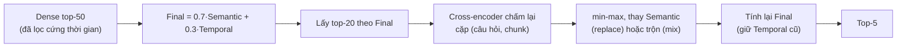

# Báo cáo tuần 4

Từ 17/10 đến 22/10. Tuần 3 dựng xong code Cơ chế 1; tuần này **đo nó và cải tiến theo số liệu**: dựng bộ đánh giá có nhãn chunk, chạy đủ loại kịch bản, đọc câu sai, sửa thiết kế, đo lại. Thiết kế đi từ bản gốc (2 trường hợp điểm thời gian, hybrid, lọc domain) tới bản hiện tại ([`design/03`](../../design/03_TEMPORAL_RETRIEVAL_DESIGN_V2.md)) qua khoảng sáu vòng "đo → chẩn đoán → sửa → đo lại".

Tài liệu gốc của từng vòng: kế hoạch đợt test [`eval/03`](../../eval/03_TEST_ROUNDS.md); kết quả bộ local [`eval/04`](../../eval/04_TEST_RESULTS.md); kết quả bộ thật [`eval/05`](../../eval/05_REAL_RESULTS.md); quyết định [`decisions/01` đến `08`](../../decisions/); nhật ký code [`process/06` đến `08`](../../process/).

**Quy ước đọc số.** `hit@k` = chunk đúng (theo id) nằm trong top-k; `mrr` = trung bình `1/hạng` của chunk đúng; `ans_valid@5` = top-5 có chunk vừa chứa chuỗi đáp án vừa **hợp lệ về thời gian** tại `T_req`; `leakage_rate` = tỉ lệ câu có chunk bắt đầu sau `T_req`. Ghi "± x" là khoảng 95% khi so **ghép cặp từng câu**. Trên bộ thật (400 câu), chênh dưới khoảng 0.013 đến 0.015 `mrr` là không phân biệt được.

---

## 1. Điểm xuất phát: thiết kế gốc

Thiết kế ở [`design/02`](../../design/02_TEMPORAL_RETRIEVAL_DESIGN.md) và code tuần 3:

| Khâu | Bản gốc |
|---|---|
| Nạp kho | LLM trích `start`, `end` cho từng chunk; chunk không có mốc thì bỏ |
| Profiler | Một điểm `T_req` (khoảng thời gian lấy mốc cuối) |
| Tìm ứng viên | Hybrid: dense + BM25 gộp RRF |
| Lọc cứng | `start ≤ T_req`, `invalidated_at` rỗng, `domain` |
| Chấm điểm | `Final = 0.7·Semantic + 0.3·Temporal`; `Temporal` = 1.0 nếu `T_req ∈ [start, end]`, không thì `exp(−λ·Δ năm)` |
| Đối chứng | Chưa có Plain RAG |

---

## 2. Bộ đánh giá và kết quả đầu tiên (bộ local, 40 câu)

**Dựng bộ.** `scripts/make_eval_subset.py` lấy mẫu theo chủ đề từ TimeQA, đổi vị trí đáp án thành nhãn **chunk đúng** (`gold_chunk_ids`). Bộ **local**: 40 câu (8 domain × 5), 37 trang, mức câu hỏi `hard`. Bộ **thật** (làm sau): 400 câu (8 domain × 50), 204 trang. Quy trình: [`process/06`](../../process/06_EVAL_SUBSET.md).

**Nạp kho local** (LLM Gemini qua cổng 9router): 37 trang, 1,275 chunk; 1,058 chunk có mốc, 216 không có mốc (`no_time`). **39/41 chunk đáp án còn trong kho**, nên 95% là trần của `hit@k` ([`eval/01`](../../eval/01_LOCAL_INGESTION.md)). LLM đặt `ongoing = true` ở 177 chunk, trong đó 42 chunk chính lời giải thích của LLM nói là không có ngày kết thúc: dấu hiệu đầu tiên của vấn đề `end`.

**Kết quả đầu** ([`eval/02`](../../eval/02_RETRIEVAL_LOCAL.md), 37 câu có thể trúng, sai số khoảng ±15 điểm phần trăm):

| Cấu hình | `hit@1` | `hit@5` | `mrr` |
|---|---|---|---|
| Cơ chế 1, `T_req` từ Profiler | 0.270 | 0.730 | 0.446 |
| Bỏ `Temporal` (vẫn lọc cứng) | 0.216 | 0.703 | 0.385 |
| Oracle (`T_req` từ nhãn) | 0.270 | 0.784 | 0.445 |

Rò rỉ tương lai và chunk bị vô hiệu đều **0%**. Điểm thời gian có vẻ giúp (`mrr` +0.06) nhưng chưa vượt sai số. Hai phát hiện định hướng cả tuần:
- Profiler **không phải điểm nghẽn**: `T_req` nằm trong khoảng nhãn ở 40/40 câu, oracle ngang e2e.
- Khó khăn chính là **chọn đúng chunk trong cùng một trang**: một trang có vài chục chunk cùng chủ đề (cùng một người, cùng một đội) khác nhau chỉ ở thời kỳ.

Khi đó chưa có Plain RAG, nên chưa trả lời được "hệ có hơn RAG thường không".

---

## 3. Vòng 1 (19/10): thêm đối chứng và các thành phần còn thiếu, đo trên local

Thêm vào code (đều tùy chọn): `PlainRetriever` (dense / BM25 / hybrid, không lọc thời gian), trọng số BM25 trong RRF (`sparse_weight`), `end_status` + 4 cách chấm `end` (`end_mode`), nhánh chunk **không mốc** (`t_unknown`), cộng điểm `domain` (`W3`), lấy chunk liền kề, số đo từng bước ("phễu"), metric cho câu cần nhiều chunk. Chạy 142 kịch bản trên local theo đợt 0 đến 5 ([`eval/03`](../../eval/03_TEST_ROUNDS.md)).

**Quyết định rút ra** (mỗi cái có file riêng):
- [`01`](../../decisions/01_DOMAIN_AS_SOFT_BOOST.md): `domain` chỉ **cộng điểm**, không lọc cứng. Lọc cứng cần cả nhãn chunk lẫn nhãn câu hỏi cùng đúng; một bên sai là mất đáp án. Profiler chỉ điền `domain` cho khoảng 14/40 câu, nên thành phần này ít tác dụng.
- [`02`](../../decisions/02_END_TIME_ONGOING.md): `end` có ba trạng thái (`known`, `unknown`, `ongoing`); `ongoing` phải có **câu bằng chứng nguyên văn** trong văn bản, nếu không bị hạ xuống. Cách chấm: `stored`, `open`, `decay`, `unknown_decay` (chỉ `unknown` giảm dần).
- [`04`](../../decisions/04_UNDATED_CHUNKS.md): giữ chunk không mốc (`--keep-undated`) và cho điểm cố định `t_unknown`, vì câu trả lời ổn định theo thời gian thường không nêu năm.
- [`05`](../../decisions/05_EXCLUDE_BEFORE_COMMON_ERA.md): bỏ mốc trước Công nguyên.

**Mức đóng góp từng thành phần (cùng một bộ, `mrr`; local 40 câu, thật 400 câu)** — bảng gốc [`eval/05` mục 6.10](../../eval/05_REAL_RESULTS.md):

| Bước | Local `mrr` | Thật `mrr` | Thật `hit@5` | Thật `ans_valid@5` |
|---|---|---|---|---|
| 0. Plain RAG dense (không lọc thời gian) | 0.340 | 0.339 | 0.549 | 0.409 |
| 1. Cơ chế 1: hybrid, `stored`, không chunk không mốc | 0.420 | 0.386 | 0.627 | 0.624 |
| 2. + bỏ BM25 (chỉ dense) | 0.494 | 0.418 | 0.622 | 0.644 |
| 3. + nhánh chunk không mốc `t_unknown` 0.1 | 0.542 | 0.441 | 0.679 | 0.637 |

Đọc: lọc thời gian + điểm thời gian cho phần lớn mức tăng và **đưa `leakage_rate` từ 0.665 (Plain RAG) về 0**; bỏ BM25 và giữ chunk không mốc đều có lợi.

---

## 4. Vòng 2 (20/10): chạy lại toàn bộ trên bộ thật 400 câu

Nạp kho 204 trang (6,737 chunk) bằng Gemini 3.5 flash-lite **gọi thẳng API Google** (đổi từ 9router: cổng này bỏ qua yêu cầu structured output ở request đầu nên mỗi lô tốn hai request); Profiler Gemini 3.1; chạy lại **142 kịch bản** của local ([`eval/05`](../../eval/05_REAL_RESULTS.md)).

| Kiểm tra | Kết quả |
|---|---|
| Thứ hạng cấu hình local có chuyển sang bộ thật không | Có: tương quan hạng Spearman **0.961** (`mrr`), 0.806 (`hit@5`); cấu hình tốt nhất ở local đứng hạng 7/140 ở bộ thật, kém số 1 chỉ 0.006 |
| Cơ chế 1 so Plain RAG (ghép cặp) | `mrr` **+0.104 ± 0.036**; `leakage_rate` 0.665 xuống 0 |
| Điểm tuyệt đối | Thấp hơn local: `mrr` cao nhất 0.452, `hit@5` 0.692 (local 0.581 và 0.825): local nhỏ và dễ |
| Bỏ BM25 | dense hơn hybrid +0.032 ± 0.025 |
| Bật `t_unknown` 0.1 | +0.023 ± 0.016; đỉnh ở 0.0 đến 0.2, vượt 0.5 thì xuống dưới mức tắt |
| `unknown_decay` so `stored` | **Không còn hơn** (+0.003 ± 0.010): kết quả local là do chọn lọc trên 40 câu |
| Domain (cộng điểm hoặc lọc cứng) | Không hơn nền; lọc cứng làm giảm (0.381 so 0.386) |
| Chunk liền kề ±1 (không đổi xếp hạng) | `ctx_hit` (chunk đúng có trong ngữ cảnh) 0.679 lên 0.772 |

**Chẩn đoán "phễu"** (vì sao `hit@5` chỉ 0.69): Profiler đúng (391/400 câu `T_req` nằm trong khoảng nhãn); 94% chunk đúng bị xếp sau top-5 là do **chunk khác của chính trang đáp án** (thời kỳ khác) xếp trước; 9.3% câu bị lọc cứng mất chunk đúng vì nhãn chunk nằm sau `T_req`. Sau khi đọc tay: 75% câu sai là do **nhãn thời gian lúc nạp kho không khớp thời điểm hỏi** (ví dụ "chuyển tới London năm 1950" bị gán `start = end = 1950` như một trạng thái đã kết thúc, trong khi trạng thái kéo dài), chỉ 3/123 do Profiler.

---

## 5. Vòng 3 (20/10): Profiler khoảng, chế độ khoảng, `decay_from`, chỉ số chuỗi đáp án

Dựa trên phân tích trên, code các đề xuất ở [`decisions/07`](../../decisions/07_RANKING_AND_TIME_RANGE_PROPOSALS.md), **mọi thứ tùy chọn, mặc định giữ hành vi cũ**:

| Thay đổi | Ý tưởng | Kết quả trên 400 câu thật |
|---|---|---|
| Profiler khoảng (prompt `v2`) | LLM ghi mốc một phần + `bound` (`exact`/`after`/`before`/`none`), **code** mở rộng thành `[qs, qe]`; khoảng giao nhãn ở 395/400 câu (điểm cũ: 390) | `mrr` 0.441 lên 0.445 |
| `decay_from: end` | Chunk hết hạn bị phạt theo khoảng cách từ `end`, không từ `start` | +0.006 ± 0.008, nhất quán nhất (0.451) |
| `unknown_decay` 0.05 + `end` | Chỉ chunk `unknown` giảm dần | 0.463 |
| Chế độ `range` | Lọc `start ≤ qe`, điểm chồng lấn khoảng hỏi | **+0.002 ± 0.014**: không vượt sai số (chỉ 31/399 câu đổi hạng) |
| Chỉ số chuỗi đáp án | Thêm `ans_hit@k`, `ans_valid_hit@k` ngoài `hit@k` theo id | Cho thấy `hit@5` theo id **đánh giá thấp**: top-5 chứa chuỗi đáp án ở 0.81 câu, so 0.69 |
| Mở rộng cùng trang theo thời gian | Lấy thêm chunk cùng trang còn hợp lệ tại `qs` | **Kém hơn chunk liền kề** (`ctx_hit` 0.719 so 0.774 cho ±2) vì chính nhãn thời gian là phần sai |

Nhận xét: các tinh chỉnh ở **lớp xếp hạng thời gian** đã chạm trần (mỗi cái +0.00 đến +0.01); nút thắt nằm ở **chất lượng nhãn lúc nạp kho** và **khả năng phân biệt nội dung trong cùng trang**.

---

## 6. Vòng 4 (21/10): sửa prompt nạp kho và thử suy mốc

**Prompt ingestion `v2` rồi `v3`** (file mới, giữ bản cũ; [`decisions/03`](../../decisions/03_PROMPT_CHANGELOG.md)): phân biệt **sự kiện** ("chuyển tới X năm 1950", trạng thái kéo dài tới khi có sự kiện thay thế) với **trạng thái**; không chốt `end` chỉ vì chunk viết một năm. Nạp lại toàn bộ bộ thật vào kho riêng (`tam_chunks_dev_real_v2`, 6,752 điểm, 330 lô). Nhãn: `known` 3,974 lên 4,596; `unknown` 1,238 xuống 924; chunk không mốc 1,501 xuống 1,188.

Ghép cặp kho v1 sang v3, cấu hình nền (399 câu):

| Chỉ số | v1 | v3 | Chênh lệch ghép cặp |
|---|---|---|---|
| `hit@1` | 0.326 | 0.338 | |
| `hit@5` | 0.692 | 0.723 | +0.033 ± 0.036 |
| `mrr` | 0.463 | 0.478 | +0.016 ± 0.029 |
| `ans_valid@5` | 0.632 | 0.693 | **+0.063 ± 0.042** |
| chunk đúng bị lọc cứng | 78 | 57 | |

Chỉ `ans_valid@5` vượt sai số. Cái giá: khoảng hiệu lực bị kéo quá dài ở một số chunk làm điểm thời gian mất tính phân biệt (8 câu mất). Prompt v3 được sửa sau khi đọc 123 câu sai của chính bộ này, nên **các số là cận trên**.

**Thử thêm, đều không bật** (không gọi LLM, [`eval/05`](../../eval/05_REAL_RESULTS.md) mục 6.15 và 6.16):
- `range` đo lại trên kho v3: tốt nhất +0.003 ± 0.007.
- **Suy mốc từ chunk liền kề** (chunk không mốc lấy `end` của chunk trước; chunk `unknown` lấy `start` của chunk sau; 9 kho thử): suy `end` làm `ans_valid@5` +0.037 ± 0.010 nhưng `mrr` −0.008, vì chỉ kéo dài khoảng hiệu lực chứ không đưa chunk đúng lên hạng.

Câu sai còn lại ở v3: 111/400 (v1: 123): lọc cứng 37, chunk đúng đã hết hạn xếp sau top-5 30, hợp lệ nhưng xếp sau top-5 (lỗi nội dung) 21, điểm thời gian đẩy ra 16, không mốc 4, không vào ứng viên 3.

---

## 7. Vòng 5 (21/10): cross-encoder rerank, bước cải thiện lớn nhất

Vì phần lớn câu sai còn lại là phân biệt **nội dung** trong cùng trang, thêm bước chấm lại bằng **cross-encoder** (`fastembed`, chạy CPU, tùy chọn, mặc định tắt):

Ghép cặp, nền `hit@1` 0.338, `hit@5` 0.723, `mrr` 0.478, `ans_valid@5` 0.693:

| Model | Độ trễ (20 chunk, CPU) | `hit@1` | `hit@5` | `mrr` (Δ) | `ans_valid@5` |
|---|---|---|---|---|---|
| bge-reranker-v2-m3 (int8) | ~980 ms | 0.415 | 0.795 | **0.566 (+0.088 ± 0.015)** | 0.710 |
| MiniLM-L12 | ~160 ms | 0.375 | 0.785 | 0.530 (+0.052 ± 0.012) | 0.713 |
| MiniLM-L6 | ~70 ms | 0.360 | 0.795 | 0.524 (+0.046 ± 0.015) | 0.710 |
| bge-reranker-base | ~770 ms | 0.338 | 0.782 | 0.508 (+0.030 ± 0.016) | 0.700 |
| jina-reranker-v1-turbo | ~120 ms | 0.343 | 0.765 | 0.502 (+0.024 ± 0.009) | 0.710 |

**Đối chứng công bằng — Plain RAG cũng được thêm cùng cross-encoder** (cùng nhóm top-20):

| | Plain RAG: `mrr` / `ans_valid@5` / rò rỉ | Cơ chế 1: `mrr` / `ans_valid@5` / rò rỉ |
|---|---|---|
| Không cross-encoder | 0.330 / 0.443 / 70% | 0.478 / 0.693 / 0% |
| + MiniLM-L12 | 0.425 / 0.545 / 66% | 0.528 / 0.705 / 0% |
| + bge-v2-m3 | 0.471 / 0.573 / 70% | 0.560 / 0.710 / 0% |

- Cross-encoder nâng cả Plain RAG; **phần riêng của Cơ chế 1** vẫn là +0.09 đến +0.10 `mrr` và +0.14 đến +0.16 `ans_valid@5`, rò rỉ 0.
- Với model mạnh, khoảng cách `hit@5` thu hẹp (Plain + bge 0.735 so với Cơ chế 1 không cross-encoder 0.723); khi ngữ cảnh lớn (≥ 12 chunk) Plain bắt kịp rồi nhỉnh hơn về `ctx_hit`. Vì vậy cần đo đầu-cuối EM/F1, không dừng ở `ctx_hit`.
- `ans_valid@5` gần như không đổi (0.70 đến 0.72): cross-encoder đọc nội dung, **không biết thời gian**.

**Khảo sát kèm theo (chẩn đoán trên bộ thật, không dùng để chọn cấu hình cuối):**

| Thử | Kết quả |
|---|---|
| **Bỏ `Temporal` ở bước xếp cuối** | `mrr` **−0.06 đến −0.07** ở cả ba model: điểm thời gian vẫn cần dù đã có cross-encoder |
| `w2` (trọng số thời gian) | 0 cho 0.499; 0.15 cho 0.544 đến 0.550; 0.3 cho 0.556 đến 0.566 (bge-v2-m3; lưới dở 12/28) |
| BM25 (0.25, 0.5, 1.0), nhóm top-30/50, thang chuẩn hóa `sigmoid`/`zscore`/`softmax`, nhãn v1 | Không hơn trong sai số, hoặc kém (nhãn v1 kém v3 −0.03, `softmax` −0.03 đến −0.05) |
| `replace` hay `mix`, ghép khoảng thời gian vào chữ đưa cho cross-encoder | Chênh nhỏ hơn sai số; khuyến nghị đơn giản: `replace`, không ghép |

Chọn model là đánh đổi độ trễ và chất lượng: L6 (nhanh), L12 (cân bằng), bge-v2-m3 (chất lượng, ~1 giây mỗi 20 chunk).

---

## 8. Chuẩn bị đánh giá sạch: chia tập tune / valid / test

Từ vòng 3 trở đi mình đã xem hơn 300 cấu hình và đọc câu sai trên chính bộ thật, nên bộ thật chỉ còn là **"test đã xem"**: dùng để chẩn đoán, số là cận trên, không dùng để chọn cấu hình cuối ([`decisions/08`](../../decisions/08_TRAIN_VALID_TEST_SPLIT.md), [`planning/TUNING_PLAN.md`](../../planning/TUNING_PLAN.md)).

| Tập | Số câu | Nguồn | Dùng để |
|---|---|---|---|
| `tune` | 400 | cân bằng 50/domain (D/train 237 + D/test 30 + C 133) | quét tham số (`w2`, `λ`, `end_mode`, cỡ nhóm chấm lại...) |
| `valid` | 400 | chỉ D, bám phân bố `relation` của test | chọn cấu hình, quy tắc một sai số chuẩn |
| `test_clean` | 400 | 50/domain; D/test 266 + D/train 117 + 17 câu C bù domain military, chọn theo đặc trưng độ khó | **chạy đúng một lần** ở cuối |

Ba tập không trùng `idx` hay trang với nhau (script có `assert`); chỉ loại các câu đã nằm trong bộ thật/local, không loại trang. Cách làm: `src/tam/evaluation/splits.py`, `scripts/make_splits.py` (seed 42), có test. Cỡ 400 phát hiện được chênh `mrr` khoảng 0.013. Quy tắc báo cáo: so ghép cặp là chính, số tuyệt đối báo kèm bootstrap, lớp 177 câu trang mới báo riêng.

**Tiến độ chuẩn bị dữ liệu** (đến sáng 22/10):

| Việc | Trạng thái |
|---|---|
| Nạp kho `valid` (prompt v3) | Xong: 4,884 điểm / 5,063 chunk; 21 chunk của một trang bị Gemini chặn nội dung (ảnh hưởng 1 câu) |
| Nạp kho `test_clean` | Xong: 5,572 điểm / 5,682 chunk, không chunk nào bị chặn |
| Nạp kho `tune` | Chưa: dừng ở ~35/203 lô, **hết hạn mức ngày** (500 request/model) |
| Profiler khoảng cho `valid` | Dở: khoảng 250/400 câu đã trong cache; hết hạn mức ngày của `gemini-3.1` lúc ~08:25 sáng 22/10 |
| Profiler `test_clean`, `tune` | Chưa chạy |

Việc đa luồng hóa `profile_eval.py` (`--workers`, `--rpm`) đã làm; giới hạn thực sự là 15 request/phút và 500 request/ngày của gói miễn phí, hạn mức reset khoảng 14:00 giờ VN.

---

## 9. Thiết kế hiện tại so với bản gốc

Bản mô tả đầy đủ: [`design/03_TEMPORAL_RETRIEVAL_DESIGN_V2.md`](../../design/03_TEMPORAL_RETRIEVAL_DESIGN_V2.md) (mô tả đúng cái đã code, kèm lý do và số đo).

| Khâu | Bản gốc (tuần 3) | Bản hiện tại | Vì sao đổi |
|---|---|---|---|
| Nạp kho | `start`, `end` | + `ongoing` có bằng chứng, `end_status` (`known`/`unknown`/`ongoing`), `domain`, chunk không mốc giữ lại, prompt `v3` có phân biệt sự kiện/trạng thái | 75% câu sai do nhãn thời gian lệch |
| Profiler | Một điểm | Điểm (`v1`) và khoảng `[qs, qe]` + `bound` (`v2`); dùng điểm `qs` làm chế độ chính | `range` không hơn `point` |
| Tìm ứng viên | Hybrid RRF | **Dense** (BM25 có trọng số, mặc định 0) | Bỏ BM25 +0.03 `mrr` |
| Lọc cứng | thời gian + `invalidated_at` + `domain` | thời gian + `invalidated_at`; `domain` chỉ cộng điểm; chunk không mốc có nhánh riêng | Lọc cứng domain làm giảm |
| `Temporal` | 2 trường hợp | 5 nhóm trạng thái chunk × 4 `end_mode` × 2 `decay_from`; nền `unknown_decay` 0.05, `decay_from end`, `t_unknown` 0.1 | nhãn `end` không đáng tin; chunk không mốc cứu được câu |
| Xếp hạng | `0.7·Semantic + 0.3·Temporal` | Như cũ **+ cross-encoder** chấm lại top-20 rồi tính lại `Final` | chỗ khó nhất là phân biệt nội dung trong trang |
| Ngữ cảnh | Top-5 | Tùy chọn chunk liền kề ±1 đến ±3 (báo riêng, áp cả cho Plain RAG) | +0.04 đến +0.07 `ctx_hit` |
| Đối chứng | Chưa | Plain RAG, và Plain RAG + cùng cross-encoder | cần tách đóng góp của cơ chế thời gian |

**Tiến trình `mrr` trên bộ thật 400 câu** (mỗi dòng cộng dồn lên dòng trước):

| Mốc | `mrr` | `hit@5` | `ans_valid@5` |
|---|---|---|---|
| Plain RAG dense | 0.339 | 0.549 | 0.409 |
| Cơ chế 1 đầu tiên (hybrid) | 0.386 | 0.627 | 0.624 |
| + dense, + chunk không mốc | 0.441 | 0.679 | 0.637 |
| + Profiler khoảng, `decay_from end`, `unknown_decay` | 0.463 | 0.692 | 0.632 |
| + nạp kho prompt `v3` | 0.478 | 0.723 | 0.693 |
| + cross-encoder MiniLM-L6 / L12 | 0.524 / 0.530 | 0.795 / 0.785 | 0.710 / 0.713 |
| + cross-encoder bge-reranker-v2-m3 | **0.566** | 0.795 | 0.710 |

Cảnh báo: các dòng sau dòng 2 chọn cấu hình ngay trên bộ này (cận trên); mức chênh Plain RAG so Cơ chế 1 (+0.09 đến +0.10 `mrr` ở cùng cross-encoder) là ghép cặp và đáng tin hơn con số tuyệt đối. Plain RAG trong lượt đối chứng sau có `mrr` 0.330 (kho v3), hơi khác 0.339 ban đầu.

---

### 📌 Kết luận Tuần 4

- **Đã trả lời được câu hỏi chính của Cơ chế 1:** hơn Plain RAG rõ ràng (`mrr` +0.09 đến +0.10 ghép cặp, kể cả khi cả hai đều có cross-encoder) và **không rò rỉ tương lai** (Plain RAG rò rỉ 66% đến 70% câu).
- **Cái thật sự đã tăng điểm**, theo thứ tự: lọc và điểm thời gian (+0.05 `mrr`), bỏ BM25 (+0.03), giữ chunk không mốc (+0.02), sửa nhãn lúc nạp kho (`ans_valid@5` +0.06), cross-encoder (+0.05 đến +0.09). **Không giúp** trong sai số: chế độ `range`, `unknown_decay` hơn `stored`, lọc domain, mở rộng cùng trang theo thời gian, suy mốc từ chunk liền kề, BM25 khi đã có cross-encoder.
- **Điểm yếu còn lại:** `ans_valid@5` chỉ khoảng 0.71 (cross-encoder không biết thời gian); nhãn thời gian lệch vẫn là nguyên nhân của khoảng một phần ba câu sai (chunk đúng bị lọc cứng); ở ngữ cảnh lớn Plain RAG đuổi kịp về `ctx_hit`.
- **Hạn chế phương pháp:** mọi con số trên bộ thật là cận trên (đã xem hơn 300 cấu hình, đọc câu sai rồi sửa prompt). Số liệu sạch chỉ có sau khi tune/valid/test xong.
- **Cản trở thực tế:** hạn mức miễn phí Gemini (500 request/ngày/model, 15/phút) làm chậm nạp kho `tune` và Profiler của ba tập; máy laptop nóng 97 đến 99°C khi chạy nhiều tiến trình song song nên giữ tối đa ba.
- **Tuần sau (tuần 5):** (1) xong Profiler cho `valid`, `test_clean`, `tune` và nạp kho `tune` khi hạn mức reset; (2) đo `valid` 3 mức cross-encoder cùng đối chứng, chọn theo quy tắc một sai số chuẩn; (3) quét tham số (`w2`, `λ`, `end_mode`, `t_unknown`, cỡ nhóm chấm lại) trên `tune`, khóa cấu hình; (4) cổng đầu-cuối **EM/F1** có LLM sinh câu trả lời, so Plain RAG cùng bộ sinh; (5) chạy `test_clean` **một lần**, báo micro/macro kèm bootstrap; (6) nếu còn thời gian: prompt nạp kho `v4` (luật nguồn của `end`), bắt đầu Cơ chế 2.
