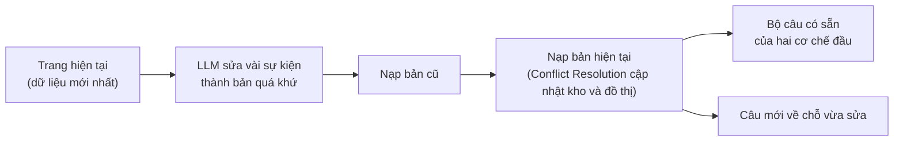
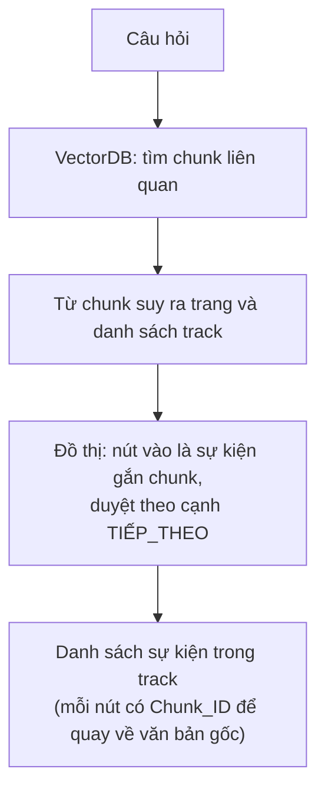
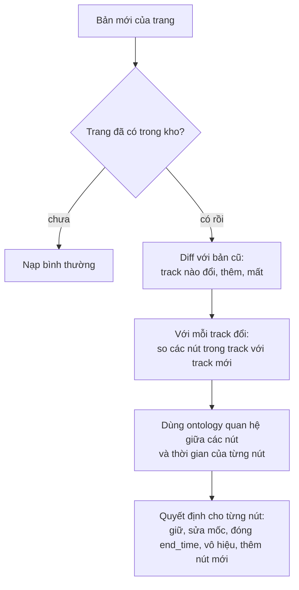

# Báo cáo tuần 6

Tuần này **hoàn thiện bộ test của Temporal Retrieval, đề xuất cách xây bộ dữ liệu cho Timeline Summarization và Conflict Resolution, và thiết kế sơ bộ cách hai cơ chế này chạy**. Các bước đã làm:
1. Viết thêm các bộ câu hỏi cho Temporal Retrieval về thời điểm hiện tại (`T_now`), test lại cấu hình chính và chọn lại.
2. Đề xuất cách xây bộ dữ liệu cho Timeline Summarization: chia trang Wikipedia thành các track sự kiện, rồi sinh câu hỏi từ track. Trích xong track và sự kiện cho tập train (tune) và valid.
3. Đề xuất cách xây bộ dữ liệu cho Conflict Resolution: coi trang hiện tại là dữ liệu mới nhất, dùng LLM sửa vài sự kiện để mô phỏng dữ liệu quá khứ.
4. Thiết kế sơ bộ cách chạy Timeline Summarization và Conflict Resolution.

**Kết quả chính:**

| Việc | Kết quả |
|---|---|
| Bộ test Temporal Retrieval | thêm 4 bộ, mỗi bộ 100 câu (34 câu về `T_now`) |
| Test lại Temporal Retrieval trên các bộ mới | cách chấm `end_mode = unknown_decay` tốt hơn `decay` (cấu hình cũ); rò rỉ tương lai (`leakage_rate`) vẫn 0% |
| Track và sự kiện cho Timeline Summarization | xong tập train và valid: 355 file, 11.979 sự kiện (khoảng 34 sự kiện mỗi trang) |
| Tập test của Timeline Summarization | chưa làm |

---

## 1. Hoàn thiện bộ test của Temporal Retrieval: thêm câu hỏi liên quan `T_now`

**Vì sao cần:** bộ câu hỏi cũ (TimeQA) gần như không có câu thời gian tương đối. Chưa biết hệ trả lời thế nào khi người dùng hỏi "hiện tại" hay "5 năm trước", mà các câu này cần đổi sang ngày tuyệt đối bằng `T_now` (ngày giờ của máy chủ, ở đây cố định `2026-11-03`).

**Cách làm:** viết tay thêm 4 bộ, mỗi bộ 100 câu, viết từ chính chunk gốc (hai bộ trên trang của tập test cũ, một bộ trên trang tune, một bộ trên trang valid). Mỗi bộ có 4 loại:

| Loại | Số câu | Ví dụ thật trong bộ |
|---|---:|---|
| Thời gian tương đối (`relative`) | 34 | "Who headed Stord's municipality 12 years ago?" |
| Mức ngày (`day`) | 31 | hỏi đúng một ngày cụ thể |
| Không nêu mốc (`no_anchor`) | 18 | hỏi không có thời điểm, mặc định là hiện tại |
| `end_time` còn mở (`open_end`) | 17 | chunk nói "từ 1994 đến nay", chưa có ngày kết thúc |

Các câu `relative` gồm hai dạng: "hiện tại" ("Who is Gamvik's current mayor?") và "N năm trước".

**Test lại:** chạy lại 1.141 cấu hình trên các bộ mới và so với cấu hình chính cũ. Kết quả: cách chấm `end_mode = unknown_decay` tốt hơn `decay` (cấu hình chính cũ) ở các bộ câu mới; ở các bộ cũ hai cách ngang nhau. Cơ chế thời gian vẫn thắng Plain RAG: rò rỉ tương lai (`leakage_rate`) 0%, trong khi Plain RAG rò rỉ khoảng một nửa số câu.

**Mỗi `end_mode` là gì** (khác nhau ở cách cho điểm thời gian với chunk chưa có ngày kết thúc):

| `end_mode` | Chunk còn hiệu lực (`ongoing`, ví dụ "từ 1994 đến nay") | Chunk không rõ trạng thái (`unknown`) |
|---|---|---|
| `stored` | điểm thời gian 1.0 mãi | coi như đã hết hạn |
| `decay` (cấu hình cũ) | giảm theo số năm từ ngày bắt đầu đến thời điểm hỏi | giảm như `ongoing` |
| `unknown_decay` (mới) | giữ 1.0 | giảm theo số năm |

**Dự đoán lý do `unknown_decay` tốt hơn** (chưa kiểm riêng): với `decay`, chunk đúng bắt đầu từ lâu bị phạt nặng khi hỏi "hiện tại" (ví dụ "MIT từ 1994" đã 33 năm thì điểm chỉ còn khoảng 0.04), nên chunk khác bắt đầu gần đây lên trên. `unknown_decay` không phạt chunk đã biết là còn hiệu lực, chỉ giảm chunk chưa rõ.

**Số liệu** (Δ `mrr` của cấu hình mới so với cấu hình chính cũ, chỉ đổi `end_mode`):

| Bộ | Δ `mrr` |
|---|---|
| tune mới (100 câu) | +0.093 ± 0.021 |
| valid mới (100 câu) | +0.065 ± 0.026 |
| bộ test cũ, bản 1 (100 câu) | +0.055 ± 0.017 |
| bộ test cũ, bản 2 (100 câu) | +0.069 ± 0.022 |
| tune cũ (595 câu) | −0.007 ± 0.006 |
| valid cũ (399 câu) | −0.014 ± 0.007 |

Cấu hình chính mới (X, dùng `unknown_decay`) chạy lại tập test cũ (400 câu): `mrr` 0.619 so với 0.620 của cấu hình cũ.

Chi tiết: [`../eval/09_CAPABILITY_PROBE_RESULTS.md`](../eval/09_CAPABILITY_PROBE_RESULTS.md).

---

## 2. Đề xuất cách xây bộ dữ liệu cho Timeline Summarization

Đây là đề xuất, các phần ghi rõ chưa làm.

### 2.1. Track sự kiện của một trang Wikipedia

Mỗi trang Wikipedia là một thực thể (một người, một tổ chức, một địa danh). Từ trang đó trích ra các **track**: mỗi track là **danh sách các sự kiện cùng một chủ đề, kèm thời gian**. Ví dụ với trang một kỳ thủ cờ vua:

```text
track role:         2016 Bắt đầu thi đấu cho Belorechensk ... 2019 ...
track competition:  2019-09 Chặng 1 FIDE Women's Grand Prix ... 2019-12 Chặng 2 ... 2020-03 ...
track education:    ...
```

Khung track gồm 9 loại, khai trước khi viết:

| Track | Gồm |
|---|---|
| `role` | chức vụ, nhiệm kỳ, quân hàm |
| `affiliation` | nơi làm việc, đội, đảng, tổ chức |
| `location` | nơi ở, trụ sở, quốc gia |
| `ownership_structure` | sở hữu, công ty mẹ, nhà xuất bản |
| `work` | sản phẩm người đó làm ra (phát hành, dự án) |
| `naming` | tên chính thức, đổi tên |
| `family` | vợ/chồng, con |
| `education` | học tại |
| `other` | còn lại (ví dụ giải thưởng), bắt buộc kèm nhãn |

Tiêu đề mục của trang Wikipedia ("Early life", "Club career", "Honors and awards") được đưa vào làm gợi ý cho track và để kiểm chéo, không dùng làm nhãn duy nhất, vì mục "Career" chứa nhiều track.

Mỗi sự kiện gồm: ngày (kèm độ mịn năm, tháng hoặc ngày), track, câu mô tả và chunk gốc làm bằng chứng. Sự kiện chỉ nêu mơ hồ như "thập niên 1970" không vào timeline vàng mà ghi riêng.

**Hiện trạng:** đã trích xong track và sự kiện cho tập **tune và valid** (355 file, 11.979 sự kiện). Tập test chưa làm. Cách làm: LLM đọc chunk gốc của từng trang và viết, mình rà lại bằng mã (câu trích dẫn có trong chunk, ngày hợp lệ, thứ tự đúng, không trùng) và đọc tay từng đợt.

### 2.2. Các loại câu hỏi dự định xây từ track

Quy tắc: câu hỏi phải cần **từ hai sự kiện trở lên** của track. Nếu chỉ lọc theo một mốc là lấy được một sự kiện thì đó là câu của Temporal Retrieval, không đưa vào.

| Loại câu | Ví dụ | Chunk đúng | Cách chấm |
|---|---|---|---|
| Liệt kê | "Liệt kê các đội A từng chơi" | chunk của mọi sự kiện trong track | độ phủ sự kiện |
| Thứ tự, khoảng cách | "A vào đội X trước hay sau khi vào đội Y?", "cách nhau mấy năm?" | chunk của hai sự kiện | đúng/sai, số năm |
| Đầu, cuối, kế tiếp | "Sự kiện đầu tiên trong sự nghiệp?", "sau khi vào đội X thì làm gì?" | cả chuỗi, để biết đầu/cuối | đúng/sai |
| Tóm tắt theo chủ đề | "Tóm tắt sự nghiệp của A" (gộp `role` và `affiliation`) | các chunk của chủ đề | độ phủ sự kiện |

Đề xuất chỉ xét các sự kiện **có ngày rõ ràng**: câu hỏi đầu/cuối, kế tiếp ghi rõ "trong những mốc có nêu năm". Chưa chốt số câu mỗi loại (cần đếm số trang đủ điều kiện), dự kiến vài trăm câu mỗi tập.

**Cách so sánh:** (1) tìm chunk bằng vector top-k, LLM tự gom sự kiện; (2) đồ thị với timeline vàng đưa thẳng vào (đo trần); (3) đồ thị do LLM trích (hệ thật). Nếu (2) không hơn (1) rõ rệt thì Timeline Summarization không có lý do tồn tại trên bộ này.

Chi tiết: [`../eval/10_TIMELINE_DATASET_DESIGN.md`](../eval/10_TIMELINE_DATASET_DESIGN.md) (mục 3 đến 7 và 10.5aa, 10.5ab).

---

## 3. Đề xuất cách xây bộ dữ liệu cho Conflict Resolution

Đây là đề xuất, chưa dựng dữ liệu, chưa chạy gì.

### 3.1. Ý tưởng

Coi các trang Wikipedia hiện tại (đang dùng cho Temporal Retrieval và Timeline Summarization) là **dữ liệu mới nhất**. Dùng LLM sửa vài sự kiện trong trang để tạo **bản quá khứ**. Sau đó nạp bản cũ trước, nạp bản hiện tại sau, rồi hỏi và xem hệ xử lý xung đột đúng không.



### 3.2. Các kịch bản sửa (ví dụ)

| Kịch bản | Bản cũ → bản mới | Xử lý mong muốn |
|---|---|---|
| Mốc cụ thể hơn | "1991" → "12/05/1991" | thu hẹp mốc |
| Mốc mâu thuẫn | "1800 đến 1850" → "1805 đến 1845" | bản mới hơn thắng, giữ bản cũ trong lịch sử |
| Chuỗi sự nghiệp | A giữ chức 1800 đến 1850, B giữ chức 1850 đến 1900 | không xung đột, nối hai nút (thăng chức, đổi đội không phải xung đột) |
| Tiến hóa | người giữ chức mới nhậm chức khi bản cũ chưa có `end_time` | đóng `end_time` của bản cũ |
| Sai từ đầu | "nghi phạm là C" → "nhầm" | đánh dấu `invalidated_at`, không xóa |
| Bản mới bỏ mất một sự kiện | câu bị xóa khỏi trang | không tự đóng, vì vắng mặt không phải bác bỏ |
| Nhắc lại y hệt | cùng câu xuất hiện lại | không làm gì |

Mỗi chỗ sửa có **nhãn** (loại kịch bản, chunk, giá trị cũ, giá trị mới, đáp án cho từng thời điểm hỏi). Sửa bằng quy tắc lập trình là chính; LLM chỉ viết lại câu ở phần nhỏ. Model sinh bản cũ khác model xử lý xung đột. Chỉ sửa 10 đến 20% chunk để diff tiết kiệm. Khoảng một nửa chỗ sửa nằm trên chunk đúng của câu có sẵn, nửa còn lại ở chunk khác.

### 3.3. Câu hỏi để test

1. **Bộ câu có sẵn của Temporal Retrieval và Timeline Summarization chạy trực tiếp** trên kho sau khi nạp: bắt lỗi đóng nhầm hay không đóng khi tiến hóa. Một số kịch bản không được bộ này phủ (nhắc lại y hệt, bản mới bỏ sự kiện), nên cần thêm câu riêng.
2. **Câu thêm nhắm vào chỗ vừa sửa** (vài câu mỗi chỗ sửa, đáp án tính bằng mã):

| Loại câu | Kiểm gì |
|---|---|
| "Năm 2010 ai là CEO?" (bản cũ đã bị đóng) | giá trị cũ vẫn truy xuất được |
| "Có phải X không?" (X sai từ đầu) | bản sai không được trả như sự thật |
| Mốc rơi vào phần chênh (1800 đến 1805) | sửa mốc có hiệu lực |
| Câu gold nằm ở bản cũ, bản mới bỏ mất | vắng mặt không phải bác bỏ |
| "Đã thay đổi gì từ năm X?" | dấu cập nhật được lưu và dùng |
| Chuỗi sự nghiệp, nhắc lại y hệt | không đóng nhầm |

3. **Kiểm trạng thái kho trực tiếp:** so kho sau nạp với kho vàng, tính tỉ lệ đóng nhầm và bỏ sót; nạp theo hai thứ tự phải ra cùng kho; nạp lại cùng bản không đổi gì.

So sánh các cách nạp: Plain (không xử lý), Replace-all (thay hết bản cũ), Keep-all (giữ cả hai không phân biệt), nạp có xử lý xung đột.

Chi tiết: [`../decisions/12_MECHANISM_ROLES_AND_UPDATE_RULES.md`](../decisions/12_MECHANISM_ROLES_AND_UPDATE_RULES.md) (mục 4 và 7).

---

## 4. Thiết kế sơ bộ tạm thời cho Timeline Summarization và Conflict Resolution

Đây là thiết kế tạm, chưa cài và chưa test.

### 4.1. Timeline Summarization: truy vấn

Câu hỏi đi vào VectorDB để tìm chunk, từ chunk suy ra trang và track, rồi chạy trên đồ thị.



Mỗi sự kiện là một nút có ngày bắt đầu và `Chunk_ID`. Các nút của cùng một track nối nhau theo thứ tự ngày bằng cạnh `TIẾP_THEO`. Nút không có ngày rõ ràng vẫn tạo nhưng đứng ngoài chuỗi, để không làm sai thứ tự.

### 4.2. Conflict Resolution: khi nạp

Wikipedia đã chia trang theo các mục, nên mỗi mục gợi ý một track. Khi nạp một trang, hệ so với trang đã có:



- **Diff theo chunk** (băm nội dung): chunk không đổi thì không tốn lần gọi LLM, chỉ cập nhật `last_seen`. Chunk đổi, thêm hoặc mất mới đưa cho LLM cùng các nút đồ thị cũ trỏ tới chunk đó.
- **Ontology** là bảng quy ước quan hệ giữa các nút (ví dụ "cùng giữ một chức vụ" là xung đột, "đổi chức vụ kế tiếp" thì nối `TIẾP_THEO`), kết hợp với thời gian để quyết định hành động.
- LLM chỉ đề xuất; mã kiểm: câu trích dẫn phải có trong văn bản mới, hành động phải theo bảng kịch bản, mốc không tự bịa.
- Bản tóm tắt (dàn ý) trang cần lưu lại để phục vụ so sánh này; chưa quyết lưu ở đâu.

Chi tiết: [`../decisions/12_MECHANISM_ROLES_AND_UPDATE_RULES.md`](../decisions/12_MECHANISM_ROLES_AND_UPDATE_RULES.md) (mục 1, 4 và 6), [`../decisions/10_TIMELINE_GRAPH_AND_VECTOR_LINK.md`](../decisions/10_TIMELINE_GRAPH_AND_VECTOR_LINK.md).
