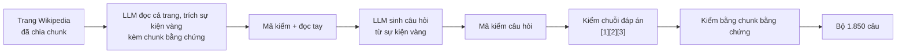

# Báo cáo tuần 7, 8, 9

Ba tuần này **hoàn thiện bộ dữ liệu cho Timeline Summarization, ingest và test cơ chế này trên cả ba tập (tune, valid, test_clean), rồi dựng dữ liệu quá khứ và bộ câu hỏi cho Conflict Resolution**. Các bước đã làm:
1. Tìm thêm được phương pháp **agentic search**: thay vì pipeline cố định (truy xuất top-k rồi mới hỏi LLM), agent tự gọi công cụ tìm kiếm nhiều lượt cho đến khi đủ bằng chứng. Ba bài tham khảo (AT2QA, Chronos, TIDER) ghi ở [`research/agentic_search/`](../../research/agentic_search/); thiết kế agent dùng trong đồ án ở [`planning/02_AGENT_SEARCH_BASELINE.md`](../../planning/02_AGENT_SEARCH_BASELINE.md).
2. Xây bộ dữ liệu Timeline Summarization: trích sự kiện vàng của 556 trang, sinh và kiểm 1.850 câu hỏi.
3. Chọn prompt ingest sự kiện, nạp graph, rồi test 9 cấu hình (pipeline cố định và agent) trên ba tập.
4. Sinh dữ liệu quá khứ (bản cũ của trang Wikipedia) và bộ câu hỏi cho Conflict Resolution.

**Kết quả chính:**

| Việc | Kết quả |
|---|---|
| Bộ dữ liệu Timeline Summarization | 556 trang, 18.711 sự kiện vàng, **1.850 câu hỏi** (tune 637, valid 554, test_clean 659) |
| Kiểm câu hỏi bằng chunk bằng chứng | đúng 99,8% với `order_gap`, 96,4% `first_last_next`, 90,1% `list`, 88,3% `summary` |
| Cấu hình tốt nhất trên cả ba tập | agent có vector và graph (cấu hình i): exact 0,860 / 0,886 / 0,897 |
| Pipeline cố định tốt nhất | hybrid trên chunk thô (cấu hình b): exact 0,747 / 0,807 / 0,780 |
| Dữ liệu quá khứ cho Conflict Resolution | 200 chỗ sửa mỗi tập (50 mỗi loại C, E, F, A), 960 câu hỏi riêng (332 / 309 / 319) |

---

## 1. Xây dựng bộ dữ liệu cho Timeline Summarization

### 1.1. Các bước

1. **Chia trang và trích sự kiện vàng.** Mỗi trang Wikipedia đã được bộ dữ liệu chia sẵn thành các đoạn (chunk), mỗi chunk thuộc một mục của trang (ví dụ "Early life", "Club career") và mang tiêu đề mục đó. LLM nhận **nguyên cả trang** (các chunk đánh số, trang dài nhất khoảng 100 chunk) trong một lượt, không chia nhỏ; thử trên trang 26 đến 45 chunk cho tỉ lệ sai và sót không tệ hơn trang ngắn nên không cần chia đoạn. LLM viết ra danh sách sự kiện có ngày của cả trang. Mỗi sự kiện gồm: ngày (kèm độ mịn năm, tháng hoặc ngày), `track`, câu mô tả, và **chunk bằng chứng** (`chunk_id` kèm câu trích nguyên văn). `track` là chủ đề của sự kiện, không phải đoạn văn: một chunk có thể chứa sự kiện của nhiều track, và một track thường trải qua nhiều chunk. Có 9 loại:

| `track` | Chủ đề (tiếng Việt) | Ví dụ |
|---|---|---|
| `role` | chức vụ, nhiệm kỳ, quân hàm | nhậm chức thị trưởng, thăng hàm đại tá |
| `affiliation` | nơi làm việc, đội bóng, đảng, tổ chức đang thuộc về | chuyển sang câu lạc bộ khác, gia nhập đảng |
| `location` | nơi ở, trụ sở, quốc gia | chuyển trụ sở sang thành phố khác |
| `ownership_structure` | sở hữu, công ty mẹ, nhà xuất bản | bị mua lại, trở thành công ty con |
| `work` | sản phẩm do thực thể làm ra | phát hành đĩa đơn, ra mắt dự án |
| `naming` | tên chính thức, đổi tên | đổi tên đội, đổi tên quảng trường |
| `family` | quan hệ gia đình | kết hôn, sinh con |
| `education` | quá trình học tập | tốt nghiệp đại học |
| `other` | còn lại (ví dụ giải thưởng, nhập ngũ), bắt buộc kèm nhãn mô tả | nhận huy chương, nhập ngũ |

Phạm vi sự kiện chọn lọc có tiêu chí (việc của chính thực thể, có ngày; bỏ số liệu thống kê, việc của thực thể khác). Mã kiểm lại: câu trích có trong chunk, ngày hợp lệ, thứ tự đúng, không trùng; sau đó đọc tay từng đợt.
2. **Gán nhãn sự kiện.** Ngoài `track`, mỗi sự kiện có thể mang cờ về độ tin cậy của ngày:

| Nhãn | Nghĩa | Ví dụ |
|---|---|---|
| (không cờ) | ngày nêu rõ trong cùng câu | "debuted on July 11, 2008" |
| `derived_date` | ngày suy ra, không nằm trong câu | "the following year", năm viết tắt "1984–85", năm lấy từ câu trước |
| `approximate_date` | ngày gần đúng | "early 2017", "circa 1949", "by 1928", mùa giải |
| `source_inconsistent` | nguồn tự mâu thuẫn về ngày hoặc một sự kiện bị ghi hai lần với hai năm | trang Talk im Turm: chunk #1 ghi Sandra Maischberger bắt đầu dẫn chương trình năm 1990, nhưng danh sách người dẫn ở chunk khác ghi "Sandra Maischberger (1991)"; trang Steele Hall ghi cùng một lần từ chức vào 15/3/1972 ở chunk này và năm 1973 ở chunk khác |

3. **Nhãn nào được tham gia loại câu hỏi nào.** Có **4 loại câu**, mỗi câu cần từ hai sự kiện trở lên (nếu một sự kiện là đủ thì đó là câu của Temporal Retrieval):

| Loại câu | Ví dụ | Chấm |
|---|---|---|
| `list` | "Liệt kê các lần đổi tên của đội" | đủ mốc, đúng thứ tự |
| `summary` | "Tóm tắt các lần bổ nhiệm vào Board X từ đầu thập niên 1990 đến 2005" (đủ mọi mốc trong một giai đoạn hẹp) | như `list` |
| `first_last_next` | "Lần cuối đội đổi huấn luyện viên là khi nào?" | mốc đáp án |
| `order_gap` | "Từ lúc thành lập đến lúc đổi tên cách nhau bao nhiêu năm?" | số năm |

| Nhãn của sự kiện | `list`, `summary` | `first_last_next`, `order_gap` |
|---|---|---|
| không cờ | dùng | dùng |
| `approximate_date` | dùng (phải khai trong câu) | **không dùng** |
| `derived_date` | **không dùng** | **không dùng** |
| `source_inconsistent` | **không dùng** | **không dùng** |

Thêm một luật cho mốc cờ nằm gần chuỗi đáp án (cách chuỗi không quá 2 năm): đáp án phải không đổi dù ngày của mốc đó lệch đến ±2 năm, nếu không thì thu hẹp phạm vi câu hoặc bỏ câu. Lý do: mốc cờ có thể làm đáp án "đầu, cuối, kế tiếp" sai mà người đọc câu hỏi không thấy.

4. **Sinh câu hỏi bằng LLM.** LLM (Haiku) đọc timeline vàng của một trang, viết trước `criterion` (loại sự kiện chuỗi thu thập) rồi viết câu hỏi từ `criterion`, ghi `gold_event_ids` và phạm vi thời gian (`window_from`, `window_to`). Quy tắc: câu hỏi tự đủ nghĩa, không lộ năm của đáp án, chuỗi phải đủ mọi mốc thỏa tiêu chí (không chọn tập con), không đếm đôi một sự kiện (thông báo và hoàn tất của cùng một thương vụ). Mã kiểm sau đó: id có trong gold, đủ số mốc, không dùng mốc bị cấm, không lộ năm.
5. **Kiểm chuỗi đáp án [1][2][3].** Câu hỏi do LLM sinh nên chuỗi đáp án có thể thiếu mốc. Kiểm bằng DeepSeek: [1] đọc cả trang và đề xuất mốc thỏa tiêu chí mà chuỗi chưa có; [2] giám khảo kiểm từng ứng viên chỉ với chunk chứa nó; [3] mã kiểm câu trích và năm có thật trong chunk, không trùng mốc đã có. Mốc đã có trong gold nhưng thiếu trong chuỗi thì thêm vào chuỗi; mốc chưa có trong gold thì bỏ câu và ghi vào `extras`. Chạy cho cả ba tập (khoảng 1.000 lần gọi [1] và 60 lần gọi [2], không lỗi); sau khi đọc tay chỉ cần sửa vài câu.
6. **Thêm bước LLM tự kiểm câu hỏi** vì câu hỏi dựa trên sự kiện vàng đã trích, nên nếu sự kiện vàng sai thì câu hỏi sai theo. Bước này đưa cho LLM **câu hỏi và các chunk bằng chứng của mọi sự kiện trong chuỗi, đánh số [1], [2], ... theo thứ tự**, yêu cầu trả lời chỉ từ các đoạn đó, rồi so với đáp án vàng. Vì LLM đọc văn bản gốc chứ không đọc sự kiện đã trích, chỗ nào hai bên lệch nhau là dấu hiệu câu hỏi mơ hồ hoặc gold sai. Các câu lệch được đọc tay và sửa lời hoặc bỏ. Kết quả cuối (1.850 câu, mỗi câu một lần): `order_gap` 0,998; `first_last_next` 0,964; `list` 0,901; `summary` 0,883 (F1 0,973 đến 0,978). Đây là cận trên vì LLM thấy đúng chunk, không phải tự truy xuất.

### 1.2. Số liệu từng tập

| | tune | valid | test_clean | Tổng |
|---|---:|---:|---:|---:|
| Trang có sự kiện vàng | 203 | 167 | 186 | 556 |
| Chunk | 5.995 | 5.063 | 5.682 | 16.740 |
| **Trang có câu hỏi** | 179 | 154 | 173 | 506 |
| **Tổng câu hỏi** | **637** | **554** | **659** | **1.850** |
| `list` | 226 | 158 | 211 | 595 |
| `summary` | 68 | 58 | 70 | 196 |
| `first_last_next` | 177 | 128 | 166 | 471 |
| `order_gap` | 166 | 210 | 212 | 588 |

Một số trang không có câu vì thiếu chuỗi đủ ba mốc hoặc bị mốc cờ chặn. Loại `order_gap` và `first_last_next` ít hơn dự kiến vì track `work` bị loại, mốc `derived_date` chặn chuỗi và nhóm "ngày không rõ" chặn chuỗi; đây là cái giá chấp nhận để câu hỏi không mơ hồ.

Chi tiết: [`eval/10_TIMELINE_DATASET_DESIGN.md`](../../eval/10_TIMELINE_DATASET_DESIGN.md), [`decisions/14_CHAIN_CHECK_AND_FLAGS.md`](../../decisions/14_CHAIN_CHECK_AND_FLAGS.md), [`decisions/15_V9_SCORING_AND_CHUNK_GOLD_CHECK.md`](../../decisions/15_V9_SCORING_AND_CHUNK_GOLD_CHECK.md).

---

## 2. Ingest và test Timeline Summarization

### 2.1. Ingest: tune prompt trích sự kiện

Ingest của cơ chế này là LLM đọc từng cửa sổ chunk (tối đa 8 chunk mỗi lượt, kèm chunk liền trước làm ngữ cảnh) và trích sự kiện; mã lọc và gộp trùng (kèm so cặp bằng LLM), rồi nạp vào Neo4j: nút sự kiện trỏ về chunk gốc (`FROM_CHUNK`), nối nhau theo thứ tự thời gian. Gold ở mục 1 đóng vai đáp án để chấm lại ingest: ghép một-một sự kiện ingest với sự kiện vàng, **recall** = tỉ lệ sự kiện vàng ingest tìm lại được, **precision** = tỉ lệ sự kiện ingest khớp vàng (gold chọn lọc có chủ ý nên precision là cận dưới).

**Prompt chốt: bản 10b** (chọn sau khi chỉnh qua khoảng 10 bản trên 5 đến 20 trang tune, mỗi cấu hình chạy một lần). Mỗi lượt trích, LLM trả cho mỗi sự kiện: `date` (ngày chuẩn hóa), `date_text` (cụm thời gian chép nguyên văn), `track`, `phase` (mốc bắt đầu hay kết thúc của một giai đoạn), `kind` (thay đổi, xảy ra một lần, kết quả, trạng thái, phát biểu), `subject` (việc của chính thực thể hay của đối tượng khác), `object` và `quote`. Các quy tắc đã chốt:
- chỉ trích sự kiện có ngày; `date_text` phải có nguyên văn trong trang (mã kiểm);
- một giai đoạn có hai đầu ("1955–1959") thành **hai mốc** (bắt đầu, kết thúc), do model tự tách; năm kết thúc viết tắt ("1823–27") được mở rộng thành 1827;
- ngày trong ngoặc, danh sách, bảng, chú thích ảnh vẫn tính, mỗi ngày một mốc;
- năm chỉ bị bỏ khi là một phần tên tác phẩm; khoảng năm chỉ nói một tài liệu bao phủ giai đoạn nào thì không phải mốc;
- `kind = result` chỉ cho kết quả một trận, một chặng, một mùa; danh hiệu và huy chương là `occurrence`.

Ở khâu nạp graph thêm hai bước: gộp sự kiện trùng (quy tắc rồi so cặp bằng LLM) và **lọc mềm** (sự kiện ngoài phạm vi vẫn nạp nhưng xếp ưu tiên thấp, thay vì bỏ). Kết quả khi chỉnh: 15 trang tune dùng để chỉnh, recall 92,1% và precision 80,7%; 20 trang tune chưa dùng để chỉnh, recall 97,0% và precision 79,2%, nhưng còn 23/82 câu có sự kiện thừa cùng loại chen vào chuỗi (15 trang đầu chỉ 5/61), tức chưa tổng quát hóa hoàn toàn.

**Điểm các bản prompt trước làm chưa tốt (và cách bản chốt xử lý):**

| Điểm yếu | Ví dụ | Xử lý |
|---|---|---|
| Chunk chỉ ghi tên tháng thì model chỉ lấy năm (bản 4) | trang Goryachkina, "in March" ghi `2019` thay vì `2019-03`; xảy ra 5/9 lần với DeepSeek | dặn ghép tháng, ngày từ cụm thời gian |
| Quy tắc "danh sách vẫn tính" kéo cả tiểu sử người khác vào (bản 6) | Trang Karlsøy có danh sách người nổi tiếng sinh ở đó; bản 5 trích 0 mốc, bản 6 trích 6 mốc ("Karl Marthinsen sinh 1896, mất 1945"...) | `subject` và `kind` để lọc mềm ở khâu nạp graph |
| Năm kết thúc viết tắt làm `date` bị bỏ trống (bản 8) | "(1823–27)" ở trang Fearnley: mốc kết thúc có `date_text` "27" nhưng `date` để trống | mở rộng thành 1827 |
| Khoảng năm của tài liệu bị coi là sự kiện (bản 8) | Trang Archaeologia Cambrensis: 8 mốc là khoảng năm của các bản mục lục ("index for 1846–1900", "1901–1960"...) | quy tắc "tài liệu bao phủ" |
| Đọc nhầm tiêu đề danh sách (bản 8) | Trang Irina Levitina: 9 mốc "won" thực ra nằm trong mục "Runners-up" | đọc tiêu đề danh sách trước khi viết "won" |
| `kind = result` quá rộng (bản 10a) | 48 mốc danh hiệu bị gán `result`, lọc theo `kind` làm recall rơi từ 94,8% xuống 85,3% | thu hẹp `result` ở bản 10b |
| Thêm `actor` để loại việc của người khác (bản 7) | lọc `actor = other` làm mất 5 đến 6/167 mốc vàng (Gemini gắn "Russia finished runner-up… in 2014" của đội tuyển Nga ở trang Goryachkina là người khác) | bỏ, giữ `subject` chỉ làm cờ |

**Điểm bản 10b còn làm chưa tốt (chưa sửa):**
- Câu không có cụm thời gian riêng nhưng thừa hưởng ngày từ câu trước bị bỏ: trang Washington Spirit, "in the 2014 … Finishing 4th, the Spirit made their first NWSL Playoff appearance" không được trích.
- Danh sách chung một ngày bị nén hoặc cắt ngang hai chunk: trang Technical University Leuna-Merseburg, "New sections were formed in 1972 from the latter two: - Economics - Mathematics…" trích thiếu từng mục.
- Hai năm trong một câu: trang Charles Holden, "London Architecture Medal for 1929 (awarded 1931)", ingest lấy 1929, gold lấy 1931.
- Một sự kiện bị trích hai lần ở hai chunk, với chữ khác nhau nên khó gộp: trang Maidan Nezalezhnosti, "Kalinin Square 1935" xuất hiện hai lần.

Graph cuối cùng (ingest lại bằng prompt 10b, **thinking tắt**):

| | tune | valid | test_clean |
|---|---:|---:|---:|
| Trang | 203 | 167 | 186 |
| Sự kiện trong graph | 8.792 | 7.490 | 8.240 |
| Lượt gọi LLM ingest | 1.793 | 1.492 | 1.656 |

Mỗi lượt ingest trung bình khoảng 6,5 giây và 353 token ra. Số recall và precision ở bảng trên đo ở các lần chỉnh prompt (một số lần thinking còn mặc định); graph cuối cùng chưa đo lại recall và precision. Chi tiết: [`eval/10_TIMELINE_DATASET_DESIGN.md`](../../eval/10_TIMELINE_DATASET_DESIGN.md) mục 10.5ae đến 10.5bl.

### 2.2. Test: các cấu hình

Cùng bộ câu hỏi, cùng LLM trả lời, cùng thước đo; mỗi cấu hình thêm một thành phần so với cấu hình trước. LLM: `deepseek-v4.1-flash` (qua OpenCode), **thinking tắt**, prompt agent giữ nguyên, mỗi cấu hình **chạy một lần**.

| # | Cấu hình | LLM nhận | Câu hỏi nó trả lời |
|---|---|---|---|
| a | Vector dense, top-15 chunk thô | chunk | mốc dưới (RAG thường) |
| b | Hybrid (dense + BM25), top-15 chunk thô | chunk | BM25 giúp được bao nhiêu |
| d | Hybrid chọn trang và chunk, lấy sự kiện đã trích của chunk đó (không đi theo graph) | sự kiện | đưa sự kiện đã trích thay chunk thô |
| f | Graph + vector: vector chọn nút vào, graph đi theo thời gian (tối đa 40 nút) | sự kiện | đi theo graph có giúp không |
| f′ | f + cửa sổ năm tách từ câu hỏi, cắt theo thùng | sự kiện | lọc cửa sổ thời gian |
| f″ | f + cửa sổ năm + lọc theo `track` | sự kiện | lọc cửa sổ và track |
| g | Agent A: công cụ văn bản (`list_pages`, `grep`, `read_page`) | agent tự đọc | agent không cần index |
| h | Agent B: công cụ vector (`vector_search`, `read_chunk`) | agent tự đọc | giá trị của vector so với g |
| i | Agent B + graph: gồm cả công cụ vector của h, thêm `events_of_chunk` (chunk thành trang và track) và `timeline` (sự kiện của một trang theo thứ tự ngày, lọc theo track và khoảng năm) | agent tự đọc | giá trị của graph so với h |
| C | Agent có cả văn bản, vector và graph | agent tự đọc | thêm văn bản vào i (chỉ chạy trên tune, xem ghi chú) |

**Cách agent tìm đường (cấu hình i):** agent tự viết truy vấn từ câu hỏi (không bắt buộc là tiêu đề trang), gọi `vector_search` để lấy các chunk gần nhất, dùng `events_of_chunk` để biết chunk đó sinh ra sự kiện của trang và track nào, rồi gọi `timeline(trang, track, khoảng năm)` để lấy chuỗi sự kiện theo thứ tự ngày (mỗi dòng kèm chunk nguồn, đọc nguyên văn bằng `read_chunk` khi cần). Các cấu hình cố định (d, f) thì ghép "tên trang. câu hỏi" làm truy vấn và hybrid chọn nút vào.

**Ghi chú về C:** C chỉ chạy trên tune. Trên tune C chỉ ngang i (hơn 0,5 điểm exact, trong dao động của một lần chạy) mà tốn thêm khoảng 39% token vào, nên không chạy tiếp trên valid và test_clean.

Hai cấu hình bị bỏ: "hybrid có lọc thời gian của Temporal Retrieval" (câu hỏi neo vào sự kiện, chỉ 78/600 câu có năm nên không có mốc thời gian để lọc) và "graph thuần không vector" (không có điểm vào). Agent dừng tối đa sau 5 lượt gọi công cụ.

**Cách đọc bảng:** *exact* = trả lời đúng hoàn toàn (đủ mốc, đúng thứ tự, không thừa); *F1* theo mốc; token vào kèm tỉ lệ nằm trong cache của nhà cung cấp; USD tính cho cả tập theo giá 0,15 (vào), 0,003 (vào, đọc cache), 0,60 (ra) USD mỗi triệu token. In đậm là điểm tốt nhất của cột (exact, F1 cao nhất; token, USD, thời gian thấp nhất).

**Tập tune** (619 câu cho d, f, f′, f″, i, C; 600 câu cho a, b, g, h vì các cấu hình này đo trước khi bộ câu thêm 19 câu)

| # | exact | F1 | token vào (cache) | token ra | lượt LLM | thời gian cả câu | USD cả tập |
|---|---:|---:|---:|---:|---:|---:|---:|
| a | 0,728 | 0,865 | 1.990 (16%) | 74 | 1 | 4,5 s | 0,18 |
| b | 0,747 | 0,864 | 2.057 (16%) | 74 | 1 | 3,8 s | 0,18 |
| d | 0,672 | 0,816 | 765 (16%) | 34 | 1 | 3,7 s | 0,07 |
| f | 0,703 | 0,825 | 1.128 (30%) | 35 | 1 | 4,0 s | 0,09 |
| f′ | 0,709 | 0,835 | 1.078 (29%) | 35 | 1 | **3,6 s** | 0,09 |
| f″ | 0,630 | 0,773 | **752** (32%) | **31** | 1 | 3,7 s | **0,06** |
| g | 0,782 | 0,870 | 7.683 (67%) | 255 | 3,94 | 13,0 s | 0,33 |
| h | 0,820 | 0,916 | 6.821 (55%) | 256 | 2,56 | 9,8 s | 0,37 |
| i | 0,860 | **0,940** | 7.627 (61%) | 247 | 2,50 | 9,7 s | 0,38 |
| C | **0,869** | **0,940** | 10.630 (khoảng 72%) | – | 3,16 | – | 0,39 |

**Tập valid** (554 câu)

| # | exact | F1 | token vào (cache) | token ra | lượt LLM | thời gian cả câu | USD cả tập |
|---|---:|---:|---:|---:|---:|---:|---:|
| a | 0,792 | 0,893 | 1.960 (18%) | 64 | 1 | **2,6 s** | 0,15 |
| b | 0,807 | 0,885 | 2.047 (19%) | 64 | 1 | 2,8 s | 0,16 |
| d | 0,751 | 0,825 | **777** (14%) | 33 | 1 | 3,2 s | 0,07 |
| f | 0,769 | 0,823 | 1.146 (26%) | 33 | 1 | 3,3 s | 0,08 |
| f′ | 0,733 | 0,807 | 1.098 (27%) | 33 | 1 | 3,3 s | 0,08 |
| f″ | 0,644 | 0,763 | 788 (30%) | **31** | 1 | 3,2 s | **0,06** |
| g | 0,829 | 0,883 | 7.457 (69%) | 252 | 3,82 | 17,4 s | 0,29 |
| h | 0,883 | 0,938 | 6.034 (57%) | 229 | 2,45 | 12,9 s | 0,30 |
| i | **0,886** | **0,947** | 7.349 (63%) | 229 | 2,43 | 12,9 s | 0,31 |

**Tập test_clean** (659 câu, chạy một lần, không chỉnh gì sau khi xem kết quả valid)

| # | exact | F1 | token vào (cache) | token ra | lượt LLM | thời gian cả câu | USD cả tập |
|---|---:|---:|---:|---:|---:|---:|---:|
| a | 0,754 | 0,865 | 1.975 (18%) | 68 | 1 | 5,5 s | 0,19 |
| b | 0,780 | 0,877 | 2.054 (19%) | 69 | 1 | 5,6 s | 0,19 |
| d | 0,689 | 0,793 | 791 (19%) | 33 | 1 | **4,1 s** | 0,08 |
| f | 0,728 | 0,826 | 1.175 (29%) | 34 | 1 | 4,2 s | 0,10 |
| f′ | 0,689 | 0,823 | 1.122 (36%) | 34 | 1 | 4,3 s | 0,09 |
| f″ | 0,619 | 0,767 | **787** (40%) | **32** | 1 | **4,1 s** | **0,06** |
| g | 0,804 | 0,859 | 7.445 (68%) | 251 | 3,83 | 19,4 s | 0,35 |
| h | 0,869 | 0,933 | 6.651 (57%) | 248 | 2,54 | 14,8 s | 0,39 |
| i | **0,897** | **0,947** | 7.984 (64%) | 244 | 2,55 | 15,0 s | 0,39 |

Điểm exact theo loại câu trên test_clean:

| # | `list` | `summary` | `first_last_next` | `order_gap` |
|---|---:|---:|---:|---:|
| a | 0,635 | 0,671 | 0,723 | 0,925 |
| b | 0,687 | 0,671 | 0,723 | 0,953 |
| d | 0,512 | 0,543 | 0,699 | 0,906 |
| f | 0,592 | 0,671 | 0,693 | 0,910 |
| g | 0,678 | 0,714 | 0,777 | 0,981 |
| h | 0,796 | 0,729 | 0,855 | **1,000** |
| i | **0,844** | **0,814** | **0,880** | 0,991 |

**Nhận xét.**
1. Agent có graph (i) đứng đầu exact và F1 ở cả ba tập; thứ tự ổn định giữa các tập: i > h > g > b > a > f > d, và f″ (lọc theo track) luôn thấp nhất vì lọc làm mất mốc ngay từ khâu truy xuất. Không có dấu hiệu overfit: trên test_clean không cấu hình nào giảm quá 6,2 điểm so với valid, i còn tăng 1,1 điểm.
2. Graph giúp trong cùng kiểu cố định: f hơn d từ 1,8 đến 3,9 điểm exact. Trong agent, graph giúp ít hơn: i hơn h 0,3 điểm ở valid, 2,8 điểm ở test_clean, 4 điểm ở tune (bộ câu khác nhau). Mỗi cấu hình chạy một lần nên chênh dưới khoảng 2 điểm chưa phân biệt được.
3. Pipeline cố định đọc chunk thô (a, b) tốt hơn pipeline đọc sự kiện đã trích (d, f), vì chunk giữ nguyên ngữ cảnh và độ phủ chunk bằng chứng cao hơn (hybrid top-15: 0,94 / 0,90 trên valid / test_clean). Phần lớn mất mát nằm ở khâu LLM chọn mốc từ danh sách sự kiện, không chỉ ở truy xuất.
4. Đánh đổi chi phí: cấu hình cố định rẻ và nhanh (0,06 đến 0,19 USD cả tập, 2,6 đến 5,6 s mỗi câu, 1 lượt gọi), agent đắt hơn 2 đến 6 lần (0,29 đến 0,39 USD) và chậm hơn 3 đến 4 lần (khoảng 10 đến 19 s, 2,5 đến 4 lượt). Khoảng 55 đến 70% token vào của agent là cache của nhà cung cấp nên USD tăng ít hơn token. Thêm công cụ văn bản vào agent (C) không đáng kể: exact ngang i (0,869 so với 0,860), tốn thêm khoảng 39% token vào.
5. **Cách đọc thời gian:** các lần chạy có nhiều tiến trình chạy song song và nhà cung cấp giới hạn tốc độ (có lúc trả 429 rồi tự chờ), nên thời gian chứa cả thời gian chờ; so được thứ tự lớn (cố định nhanh hơn agent) nhưng không so được chênh nhỏ giữa các cấu hình hoặc giữa các tập. Thời gian của C không dùng được vì bị 429 nhiều.
6. Số liệu tune của a, b, g, h chưa đo lại trên 619 câu và kho vector đã nạp thêm 97 chunk không có mốc; số tune của d, f, f′, f″, i đo lại sau khi ingest lại bằng thinking tắt (chênh với lần đo trước từ −0,3 đến +1,9 điểm, không đổi kết luận).

Chi tiết: [`eval/12_V9_TUNE600_RESULTS.md`](../../eval/12_V9_TUNE600_RESULTS.md), [`planning/02_AGENT_SEARCH_BASELINE.md`](../../planning/02_AGENT_SEARCH_BASELINE.md) (mục 14).

---

## 3. Sinh dữ liệu cũ và câu hỏi cho Conflict Resolution

### 3.1. Sinh dữ liệu cũ (bản quá khứ của trang)

Ý tưởng: trang hiện tại trong bộ dữ liệu coi là **bản mới nhất**; bản quá khứ là chính trang đó bị sửa một câu ở một số chunk. Hệ thống phải nạp bản cũ rồi cập nhật lên bản mới và xử lý đúng. Các bước:
1. **Chọn chỗ sửa:** khoảng một nửa số trang mỗi tập, mỗi trang 1 đến 2 chunk khác nhau, mỗi chunk sửa **một câu**; tổng 200 chỗ sửa mỗi tập (50 mỗi loại), khoảng 3,3% chunk. Chunk khác trong trang giữ nguyên, vừa là đối chứng "không đổi" vừa giống thực tế (sửa nhỏ trên Wikipedia chỉ đổi khoảng 1 chunk trong 74). Một nửa chỗ sửa nằm trên chunk là bằng chứng của câu hỏi Timeline Summarization.
2. **Sửa bằng 4 loại**, câu mục tiêu lấy từ sự kiện ingest có câu trích nằm trọn trong một câu của chunk:

| Loại | Ý nghĩa | Làm bằng | Bản mới (đáp án) |
|---|---|---|---|
| C | mốc lệch: đổi một năm (±1 đến 4) | mã | bản mới đúng, bản cũ sai mốc |
| E | tiến hóa (Evolution): bản cũ viết "còn tiếp diễn", bản mới đã kết thúc | LLM | bản cũ đúng đến lúc kết thúc, rồi đóng bằng `end_time` |
| F | sai từ đầu (Falsehood): đổi một giá trị (tên, nơi chốn) thành giá trị sai | LLM | bản mới đúng, bản cũ phải bị vô hiệu |
| A | đối chứng: diễn đạt lại, giữ nguyên nội dung | LLM | không được đóng hay vô hiệu nhầm |

3. **Kiểm bằng mã** từng chỗ sửa: C năm cũ còn đúng một lần; E không còn từ khóa hay năm kết thúc (và có dấu hiệu "còn tiếp diễn"); F giá trị cũ vắng, giá trị sai có mặt và không nằm sẵn trong câu gốc; A giữ nguyên tập năm và tên riêng. Chunk bản cũ có `chunk_id` dạng `<id>@past` để không ghi đè bản mới. Loại E được sinh lại bằng prompt "còn tiếp diễn" vì lần đầu khoảng 65% bản cũ chưa có dấu hiệu đó. LLM: `hy4-flash-free` (thinking bật), prompt tiếng Anh.
4. Đọc tay các chỗ hỏng và sửa; bù chỗ sửa loại E cho tập valid khi thiếu.

### 3.2. Câu hỏi cho Conflict Resolution

Có hai nguồn câu hỏi:

**(1) Câu của Timeline Summarization, chọn theo trang bị sửa.** Chỉ dùng câu của các trang được chọn để test (không dùng hết bộ). Mỗi tập chọn khoảng 95 chỗ sửa cân bằng giữa các loại (C, E, F: 26 đến 27 mỗi loại; A: 15 đến 19), mỗi chỗ trên một trang; lấy **mọi câu timeline của các trang đó**, chia thành ba nhóm theo quan hệ với chỗ sửa:
- **đích:** câu hỏi đúng sự kiện bị sửa;
- **cùng chunk:** câu về sự kiện khác nằm trong chunk bị sửa;
- **cùng trang:** câu về chunk không bị sửa (để bắt trường hợp hệ thống đóng nhầm hay đổi thừa).

**(2) Câu riêng cho Conflict Resolution (`mech3`).** Do LLM (`hy4-flash-free`) sinh 2 đến 3 câu cho mỗi chỗ sửa, đáp án gán bằng mã theo nhãn chỗ sửa:

| Loại chỗ sửa | Dạng câu | Đáp án |
|---|---|---|
| E | `current` ("A còn giữ chức X không?"), `historical` (hỏi tại một năm trước khi kết thúc) | có / không theo thời điểm |
| F | `direct` (hỏi giá trị), `verify_false` (khẳng định giá trị sai) | giá trị đúng của bản mới / "không" |
| C | `year` (hỏi năm), `verify_false` | năm đúng / "không" |
| A | `direct` (hỏi nội dung không đổi) | đúng như cũ (đối chứng) |

Quy trình kiểm: mã kiểm câu (câu ngắn, nêu rõ thực thể, đáp án bám nhãn) → LLM trả lời ba lần (kèm chunk bản mới, kèm chunk bản cũ, không kèm chunk) để loại câu mơ hồ, câu mà LLM biết sẵn đáp án từ kiến thức Wikipedia (khoảng 25 đến 30% câu bị loại vì lý do này), câu mà bản cũ không đánh lừa được mô hình → viết tay bù cho chỗ sửa còn thiếu → LLM kiểm mơ hồ (câu phải tự đủ nghĩa khi đứng một mình). Mỗi chỗ sửa có ít nhất một câu.

### 3.3. Số liệu từng tập

| | tune | valid | test_clean |
|---|---:|---:|---:|
| Trang có chỗ sửa | 105 | 101 | 110 |
| Chỗ sửa (C / E / F / A) | 200 (50 mỗi loại) | 200 (50 mỗi loại) | 200 (50 mỗi loại) |
| **Câu riêng `mech3` (bộ sạch)** | **332** | **309** | **319** |
| C / E / F / A | 71 / 87 / 66 / 108 | 78 / 83 / 66 / 82 | 80 / 91 / 68 / 80 |
| Chỗ sửa dùng để test | 97 | 93 | 98 |
| **Câu `mech3` dùng để test** | **160** | **147** | **148** |
| C / E / F / A | 38 / 45 / 33 / 44 | 40 / 43 / 37 / 27 | 43 / 48 / 33 / 24 |
| **Câu Timeline Summarization dùng để test** | **334** | **323** | **387** |
| nhóm đích / cùng chunk / cùng trang | 26 / 38 / 270 | 33 / 45 / 245 | 33 / 49 / 305 |
| `list` / `summary` / `first_last_next` / `order_gap` | 124 / 33 / 93 / 84 | 92 / 33 / 74 / 124 | 137 / 36 / 104 / 110 |

Chi tiết: [`decisions/16_MECH3_PAST_VERSION_DESIGN.md`](../../decisions/16_MECH3_PAST_VERSION_DESIGN.md).

---

## 4. Kế hoạch hai tuần tới

1. Conflict Resolution: test các cấu hình truy xuất trên dữ liệu quá khứ và so các hệ cập nhật (nạp lại cả trang, chỉ thay chunk đổi, cập nhật có LLM quyết định giữ, đóng hay vô hiệu nút cũ).
2. Triển khai agentic search cho Temporal Retrieval (Cơ chế 1), so với pipeline cố định.
3. Đo các chỉ số bằng LLM judge (giám khảo LLM chấm đúng/sai và đối chiếu bằng chứng) thay cho chấm khớp chuỗi.
